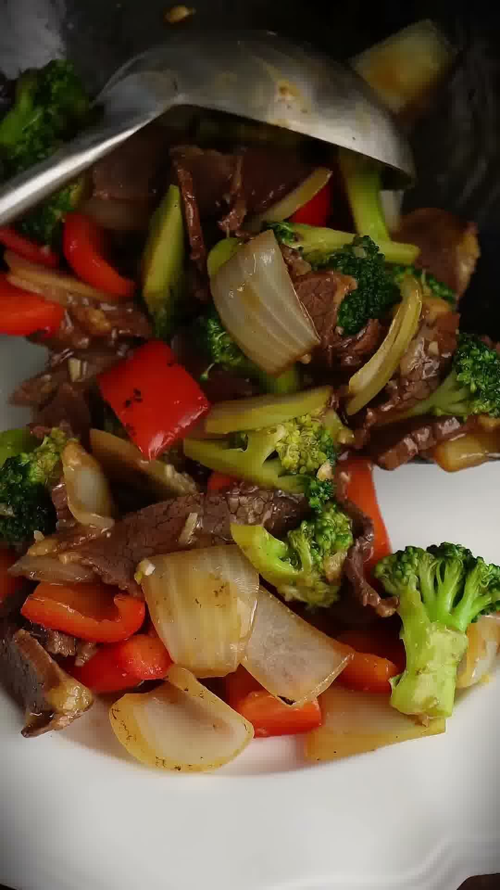
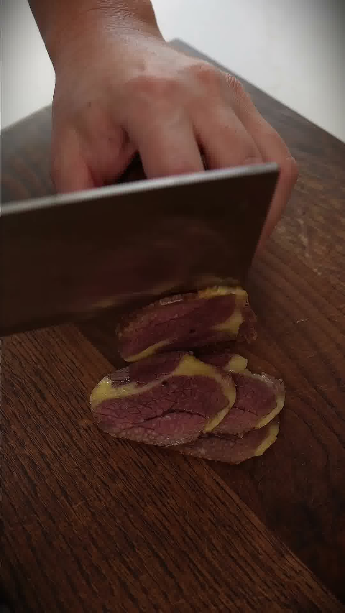
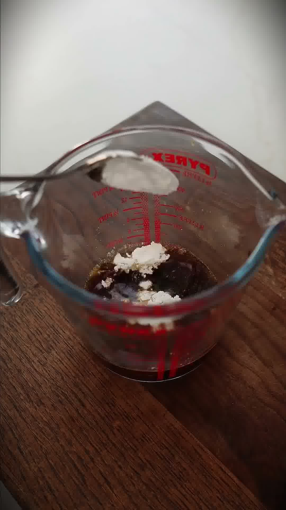
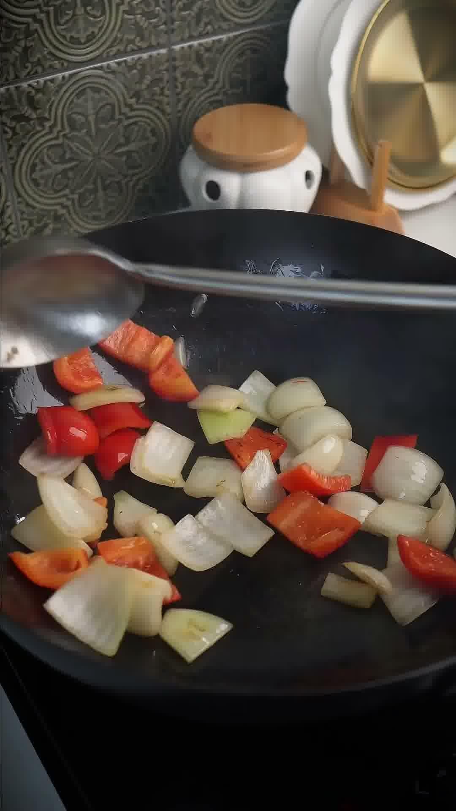
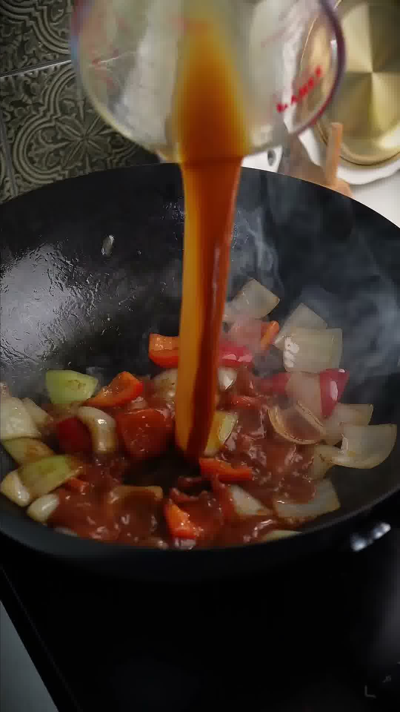
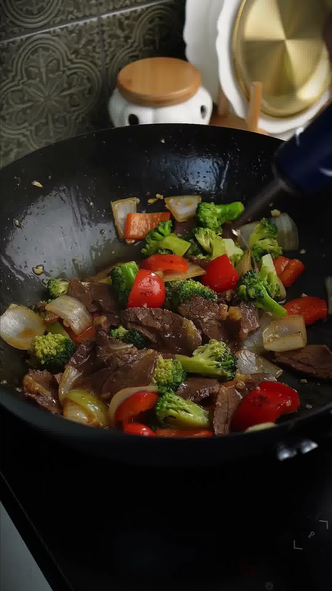
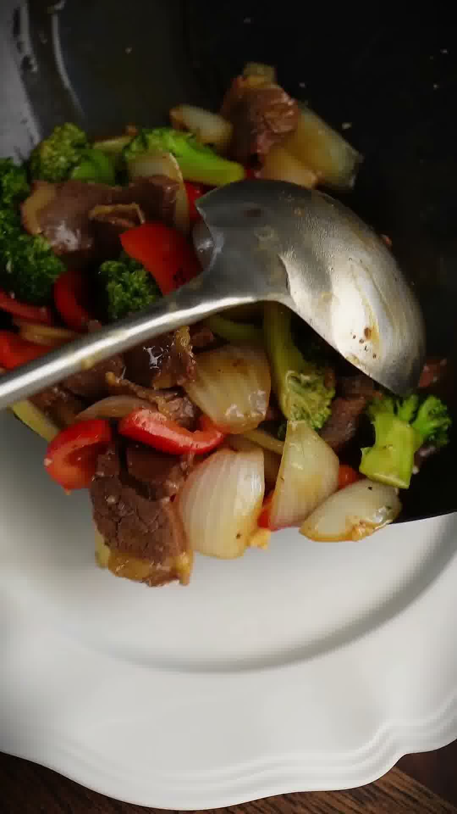

# Говядина с овощами по-китайски

Быстрый вок из отварной говядины с брокколи, луком и сладким перцем в глянцевом соусе из светлого и тёмного соевого соуса. Главное — заранее отварить мясо: дальше всё готовится за полчаса на сильном огне. Хорошо с рисом.

- **Время:** ~30 минут (плюс 1–1,5 часа, если мясо ещё не отварено)
- **Выход:** 3 порции
- **Сковорода:** вок или большая сковорода на сильном огне
- **Калорийность:** ≈ 380 ккал на порцию (оценка)

## Ингредиенты

| Продукт | Количество |
|---|---|
| Отварная говядина | 300 г |
| Брокколи | 300 г |
| Репчатый лук | 1/2 шт. |
| Болгарский перец красный | 1/2 шт. |
| Растительное масло для жарки | 2 ст. л. |
| Кулинарное вино для овощей | 2 ч. л. |
| Соль для варки овощей | 1 ч. л. |
| Растительное масло для варки овощей | 1 ст. л. |

**Соус**

| Продукт | Количество |
|---|---|
| Холодная вода | 100 мл |
| Соль | 1/4 ч. л. (по вкусу) |
| Сахар | 1/3 ч. л. |
| Глутамат натрия | 1/3 ч. л. |
| Приправа «13 специй» | 1/3 ч. л. |
| Кулинарное вино | 2 ч. л. |
| Светлый соевый соус | 2 ч. л. |
| Тёмный соевый соус | 1 ч. л. |
| Кукурузный крахмал | 1,5 ч. л. |

## Приготовление

**1. Нарежьте мясо.** Отварную говядину нарежьте тонкими ломтиками поперёк волокон — так она останется мягкой и быстрее прогреется в соусе.

**2. Смешайте соус.** В стакане соедините холодную воду, светлый и тёмный соевый соус, вино, соль, сахар, глутамат и «13 специй». Всыпьте крахмал и размешайте до однородности, чтобы не осталось комков.

**3. Подготовьте брокколи.** Разберите кочан на небольшие соцветия. В воке вскипятите воду с ложкой масла и чайной ложкой соли, опустите брокколи и бланшируйте 1–2 минуты — она должна остаться яркой и хрусткой. Выньте шумовкой.

**4. Обжарьте овощи.** Слейте воду, разогрейте вок с двумя столовыми ложками масла. Добавьте лук, нарезанный крупно, и перец полосками, обжаривайте 1–2 минуты, влейте вино и перемешайте.

**5. Влейте соус.** Вылейте соус из стакана в овощи и, помешивая, дайте ему загустеть — крахмал схватится за 30–60 секунд.

**6. Соедините с мясом.** Верните брокколи, добавьте ломтики говядины и измельчённый зубчик чеснока. Прогрейте всё вместе 1–2 минуты, чтобы мясо пропиталось соусом.

**7. Подавайте.** Сразу переложите на тарелку и подавайте с горячим рисом — остывшее блюдо теряет глянец и аромат.

## Заметки

- В ролике мясо уже отварное — его только прогревают. Если говядина сырая, отварите до мягкости (1–1,5 часа) или обжарьте отдельно до готовности и выложите к овощам в конце.
- Глутамат и «13 специй» — необязательные усилители вкуса. Без них блюдо проще, но всё равно рабочее: добавьте щепотку сахара и немного молотого перца.
- Крахмал даёт соусу глянец и густоту. Не кипятите соус долго после загустения, иначе он станет клейким.
- Чеснок в ролике кладут в самом конце, хотя в подписи автора его нет. Один зубчик заметно меняет аромат — попробуйте оба варианта.
- Брокколи можно не бланшировать, а обжарить 3–4 минуты с ложкой воды под крышкой — будет плотнее по текстуре.

## Источник

- Рецепт: [«Говядина с овощами по-китайски»](https://www.instagram.com/reel/DgHcEQWB4nD/), «Китайская кухня ТЯГУБЯ Сергей» (@luyao82), Instagram, 24.11.2026.
- Фотографии — кадры из этого видео, уменьшены для репозитория. Права принадлежат автору рецепта.
