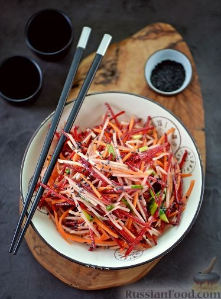
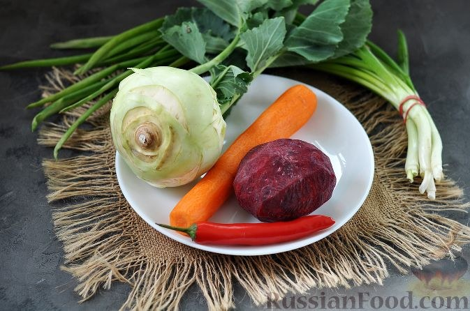
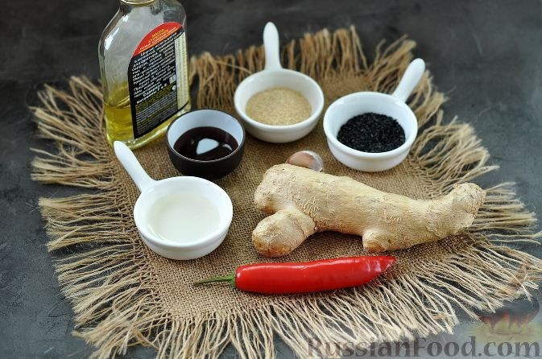
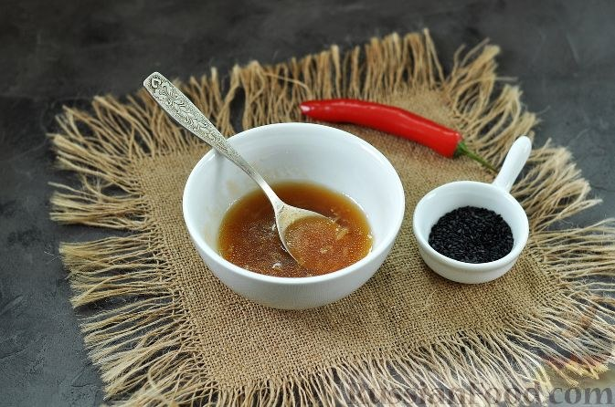
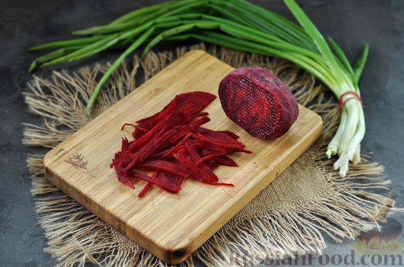
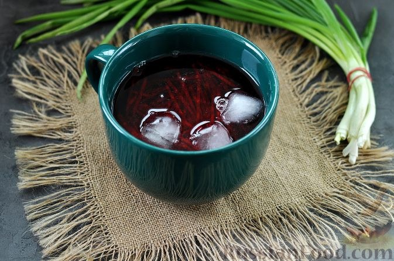
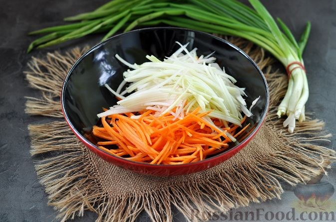
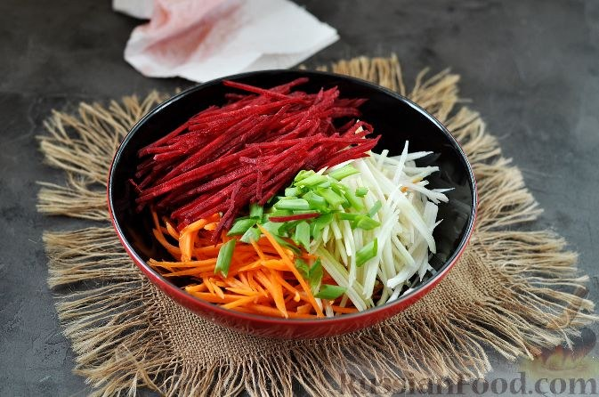
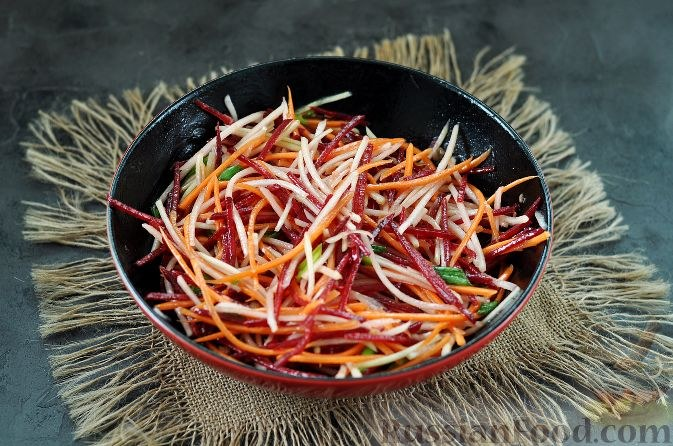
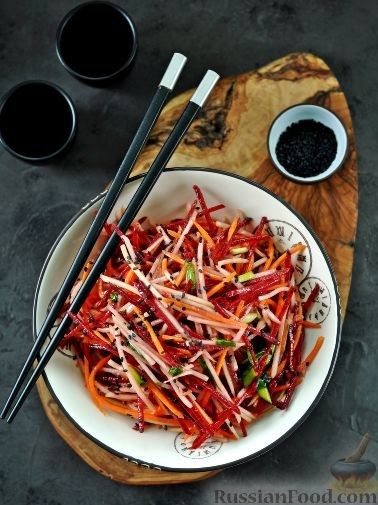

# Корейский салат

Витаминный овощной салат в азиатском стиле: кольраби, морковь и свёкла соломкой под заправкой из кунжутного масла, рисового уксуса и устричного соуса. Свёклу предварительно вымачивают в подкисленной воде — тогда она не красит остальные овощи и не отдаёт землёй.

- **Время:** ~30 минут (плюс 10–15 минут на маринование)
- **Выход:** 2 порции
- **Подача:** сразу или охлаждённым

## Ингредиенты

| Продукт | Количество |
|---|---|
| Капуста кольраби | 1 шт. |
| Морковь большая | 1 шт. |
| Свёкла маленькая | 1 шт. |
| Лук зелёный | 1 пучок |
| Масло кунжутное | 2 ст. л. |
| Уксус рисовый | 2 ст. л. |
| Соус устричный | 1 ст. л. |
| Сахар коричневый | 1 ст. л. |
| Корень имбиря | 1 см |
| Перец чили жгучий | по вкусу |
| Кунжут чёрный | 1 ст. л. |
| Соль морская | по вкусу |
| Уксус 6% (для свёклы) | 2–3 ст. л. |

## Приготовление

**1. Подготовка.** Морковь, кольраби и свёклу почистите, помойте и обсушите бумажными полотенцами. Отдельно отмерьте всё для заправки.

**2. Заправка.** Кунжутное масло, рисовый уксус, устричный соус и сахар смешайте в миске. Добавьте натёртые на мелкой тёрке имбирь и чеснок.

**3. Свёкла.** Натрите свёклу на тёрке для корейской моркови.

**4. Вымачивание.** Переложите свёклу в ледяную воду, добавьте 2–3 ст. л. 6% уксуса и оставьте на 10–15 минут. Если свёкла молодая и сладкая, этот шаг можно пропустить.

**5. Кольраби и морковь.** Натрите их на той же тёрке для корейской моркови и сложите в большую миску.

**6. Свёкла к овощам.** Слейте воду со свёклы, просушите её бумажными полотенцами и добавьте к остальным овощам.

**7. Лук и чили.** Нарежьте зелёный лук и жгучий перец, добавьте в миску.

**8. Заправка и маринование.** Полейте салат заправкой, перемешайте и оставьте на 10–15 минут. Попробуйте: если не хватает соли, добавьте морскую.

**9. Подача.** Разложите по порциям и посыпьте чёрным кунжутом.

## Заметки

- В шаге про заправку у автора упоминается чеснок, а в списке ингредиентов его нет. Одного зубчика достаточно; если не любите сырой чеснок, можно обойтись.
- Ледяная вода с уксусом убирает у свёклы землистый привкус и не даёт ей окрасить морковь и кольраби в бордовый.
- Кольраби хрустит лучше, если натереть её непосредственно перед смешиванием и не давать полежать в соли.
- Устричный соус даёт мясную глубину. Если его нет, замените соевым (1 ст. л.) и добавьте щепотку сахара.
- Салат хорош сразу, но через полчаса пропитается сильнее. На следующий день овощи уже мягче и сока больше.

## Источник

- Рецепт: [«Корейский салат»](https://www.russianfood.com/recipes/recipe.php?rid=145534), автор tasty_food, RussianFood.com, 01.04.2018.
- Фотографии — с той же страницы. Права принадлежат автору рецепта и сайту.
