# Курица с овощами в соусе хойсин

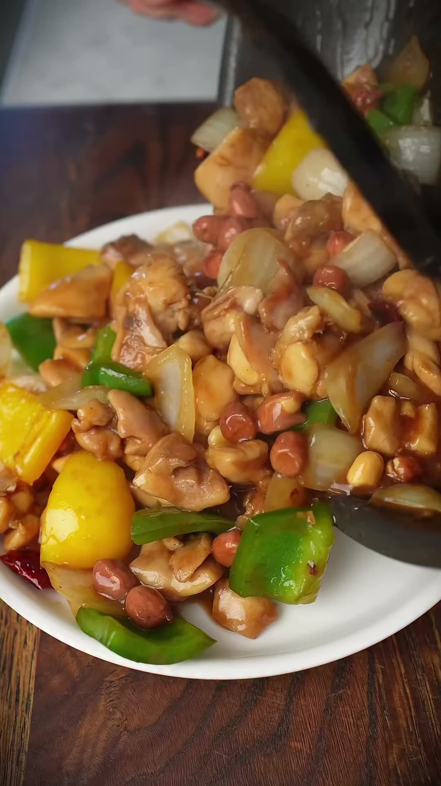

Быстрый вок по-китайски: курица, замаринованная по принципу «бархатирования» (сода, крахмал), обжаривается до румяной корочки и соединяется с хрустящими овощами в сладко-солёном соусе хойсин. Подаётся с рисом.

- **Время:** ~40 минут (из них 15 — выдержка курицы с содой)
- **Выход:** 2 порции
- **Сковорода:** вок или большая сковорода на сильном огне

## Ингредиенты

**Курица и маринад**

| Продукт | Количество |
|---|---|
| Курица (филе бедра или грудки) | 450 г |
| Сода | 1 ч. л. |
| Кулинарное вино | 1 ч. л. |
| Светлый соевый соус | 2 ч. л. |
| Куриный бульон (порошок) | 1/2 ч. л. |
| Приправа «13 специй» | 1/3 ч. л. |
| Кукурузный крахмал | 1 ч. л. |
| Растительное масло | 2 ч. л. |

**Соус**

| Продукт | Количество |
|---|---|
| Вода | 120 мл |
| Светлый соевый соус | 3 ч. л. |
| Тёмный ароматный уксус | 1 ч. л. |
| Соус хойсин | 1 ч. л. |
| Кунжутное масло | 1 ч. л. |
| Сахар | 1 ч. л. |
| Кукурузный крахмал | 1 ч. л. |

**Для жарки**

| Продукт | Количество |
|---|---|
| Растительное масло | 1 ст. л. |
| Имбирь | 2 пластинки |
| Чеснок | 1 зубчик |
| Сушёный чили-перец | 1 ст. л. |
| Болгарский перец | 1/2 шт |
| Репчатый лук | 1/2 шт |
| Кулинарное вино | 1 ч. л. |
| Жареный арахис | 2 ст. л. |

## Приготовление

**1. Сода.** Курицу нарежьте кусочками примерно 2×2 см, залейте водой с чайной ложкой соды и оставьте на 15 минут. Сода размягчает мышечные волокна — мясо останется нежным при быстрой обжарке на сильном огне.

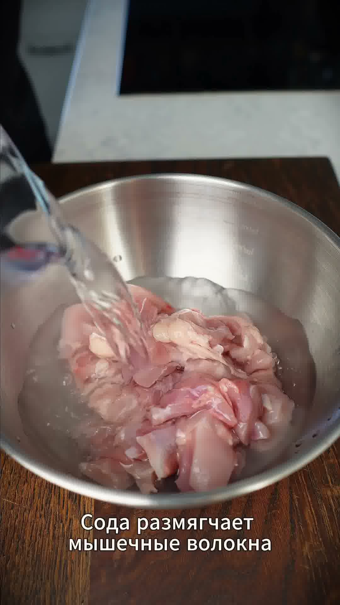

**2. Маринад.** Через 15 минут курицу промойте и хорошо отожмите от воды. Добавьте кулинарное вино, светлый соевый соус, куриный бульон и приправу «13 специй».

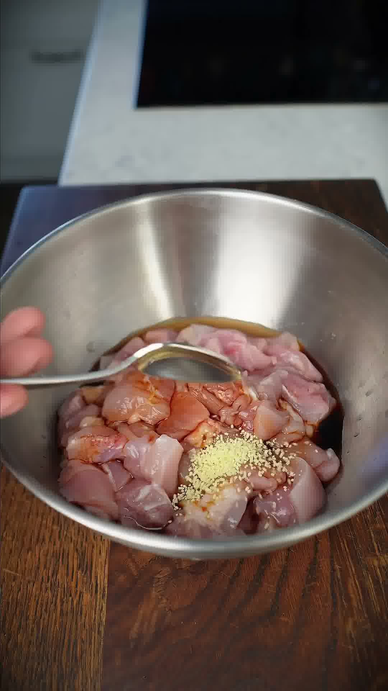

**3. Крахмал.** Всыпьте кукурузный крахмал, влейте растительное масло и перемешайте руками до однородности. Крахмал удерживает влагу внутри мяса — сохраняется сочность. Оставьте курицу мариноваться, пока готовите соус.

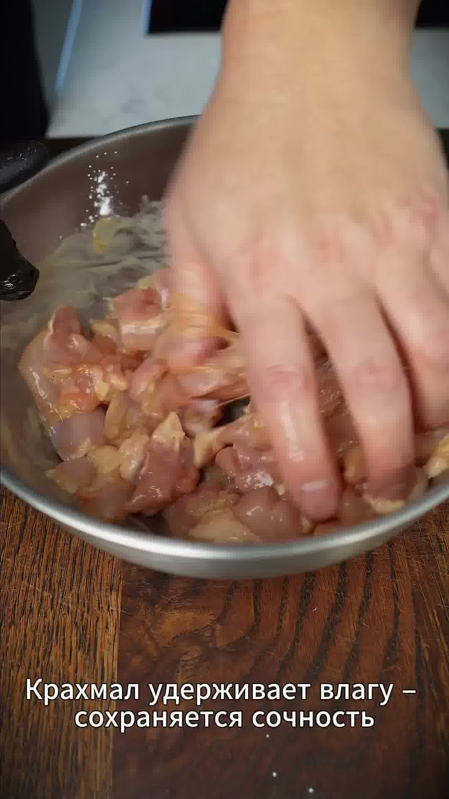

**4. Соус.** В стакане смешайте воду, светлый соевый соус, тёмный уксус, соус хойсин, кунжутное масло, сахар и кукурузный крахмал. Перемешайте до растворения сахара и крахмала — иначе при жарке соус пойдёт комками.

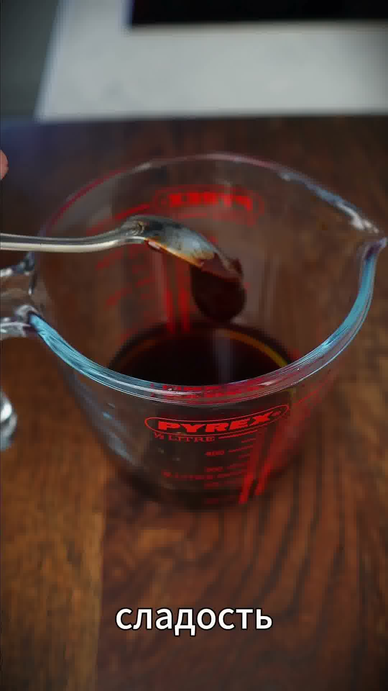

**5. Курица.** Разогрейте сковороду с маслом на сильном огне и обжарьте курицу порциями, не закладывая всё сразу, — так она румянится, а не тушится. Готовую курицу выложите на тарелку.

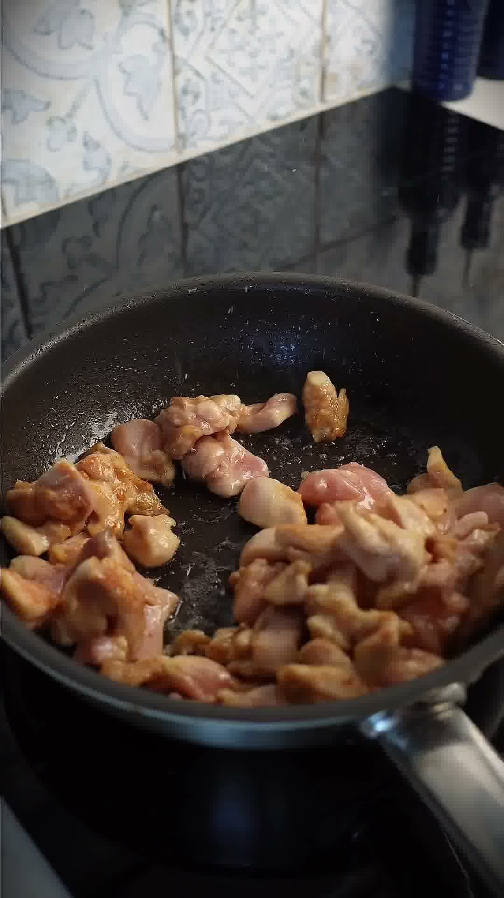

**6. Ароматика.** В той же сковороде быстро обжарьте имбирь и рубленый чеснок — до запаха, но не до коричневого цвета.

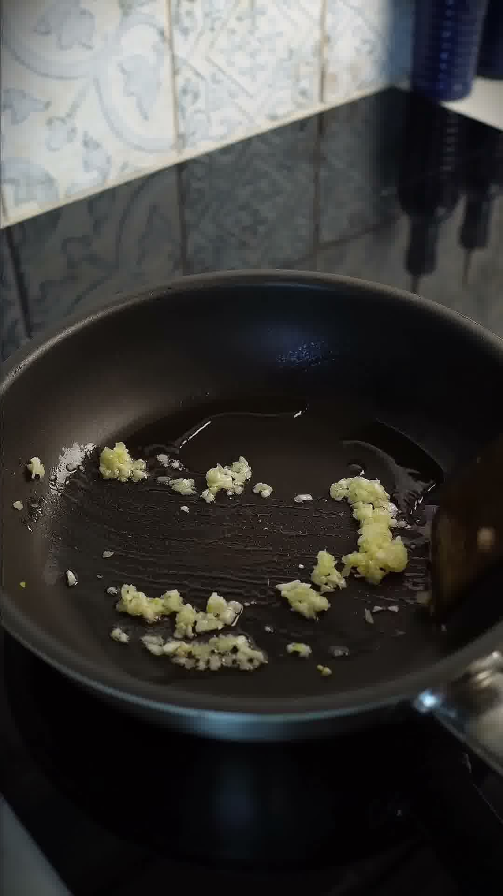

**7. Чили и овощи.** Добавьте сушёный чили, прогрейте масло, затем выложите крупно нарезанные лук и болгарский перец. Обжаривайте на сильном огне, чтобы овощи остались хрустящими.

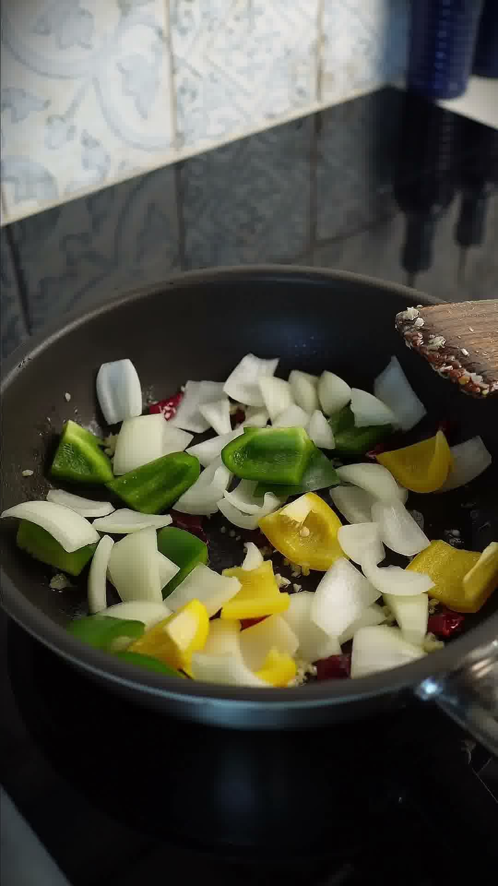

**8. Соединить.** Верните курицу в сковороду, влейте соус и кулинарное вино. Прогрейте, помешивая: крахмал в соусе загустеет и покроет мясо с овощами глянцевой глазурью.

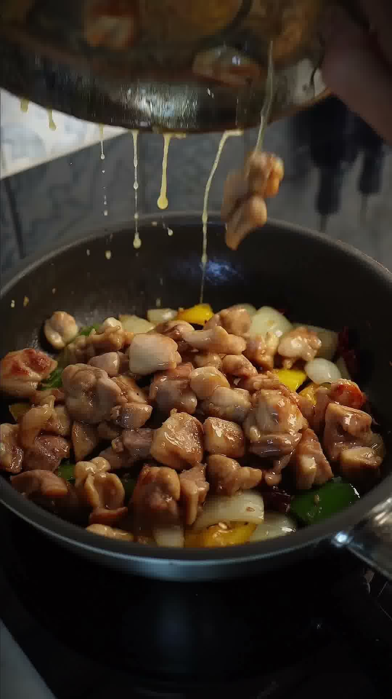

**9. Арахис.** Снимите сковороду с огня и добавьте жареный арахис — он даст хруст. Перемешайте.

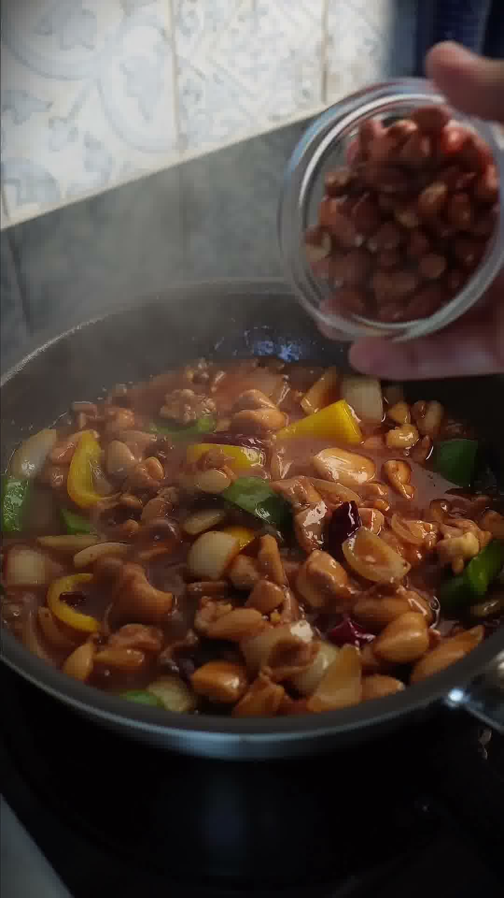

**10. Подача.** Подавайте сразу, горячим, с рассыпчатым рисом.

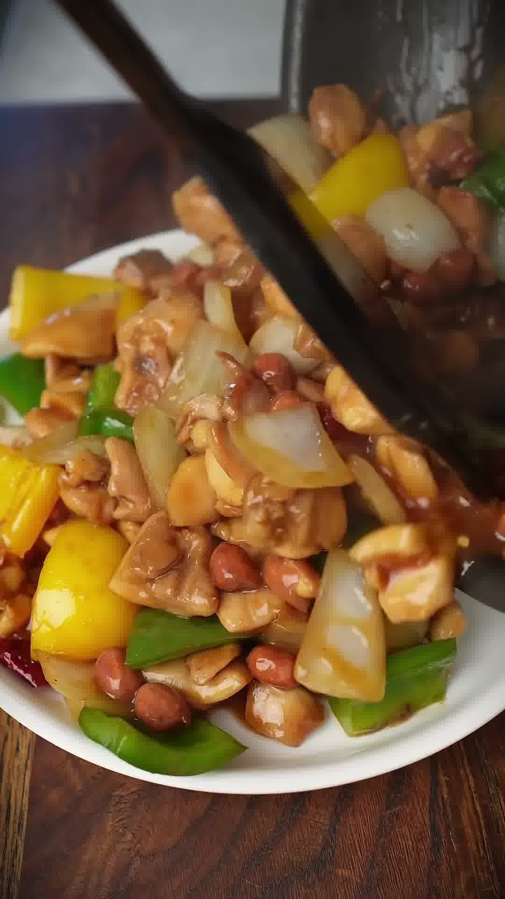

## Заметки

- **Зачем сода.** Это китайская техника «бархатирования»: щелочная среда размягчает волокна, и даже грудка не становится сухой. Передерживать нельзя — через 20–25 минут мясо начнёт разваливаться и появится мыльный привкус, поэтому 15 минут и обязательная промывка.
- **Порциями, а не всей массой.** Курица в один слой румянится; сложенная горкой — отдаёт сок и тушится.
- **Соус готовят заранее** — в воке всё происходит слишком быстро, чтобы смешивать по ходу.
- **Приправа «13 специй»** (十三香, shísān xiāng) продаётся в китайских лавках; ближайшая замена — смесь из бадьяна, сычуаньского перца, фенхеля и гвоздики.
- **Арахис — в конце и с огня.** На горячей сковороде он быстро становится горьким.

## Источник

- Рецепт: [@luyao82 (Сергей Тягубя — Китайская кухня)](https://www.instagram.com/reel/DfbrRAksLv3/), Instagram, 07.11.2026. Ингредиенты из подписи, последовательность и пояснения — по кадрам видео.
- Фотографии — кадры из того же видео, уменьшены для репозитория. Права принадлежат автору рецепта.
