# Жареная лапша с фаршем и чили-маслом

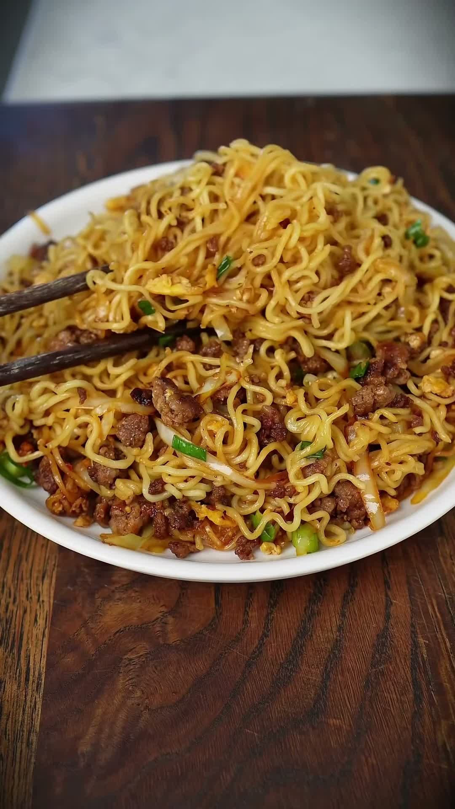

Быстрый вок по-китайски: лапша, фарш, яйцо и капуста на одной сковороде. Готовится за 15 минут, если сразу поставить воду и нарезать всё заранее.

- **Время:** ~15 минут (плюс варка лапши)
- **Выход:** 2 порции
- **Сковорода:** вок или большая сковорода на сильном огне

## Ингредиенты

| Продукт | Количество |
|---|---|
| Лапша | 2 порции |
| Растительное масло | 2 ч. л. |
| Чеснок | 1 зубчик |
| Фарш | 200 г |
| Кулинарное вино | 2 ч. л. |
| Яйцо | 1 шт |
| Капуста | 70 г |
| Светлый соевый соус | 2 ч. л. |
| Устричный соус | 1 ч. л. |
| Чили-масло или Лао Гань Ма | 1 ч. л. |
| Зелёный лук | для подачи |

## Приготовление

**1. Лапша в воду.** Поставьте воду кипятиться и бросьте лапшу. Варите по инструкции на упаковке.

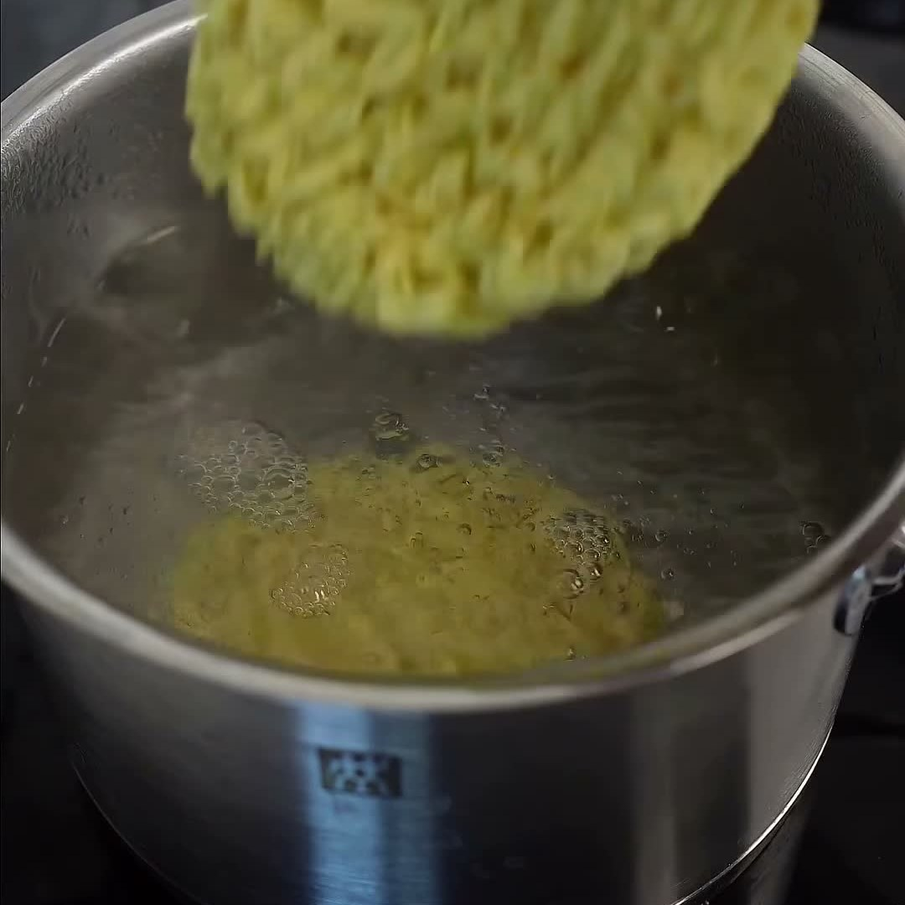

**2. Промыть в холодной.** Готовую лапшу откиньте и промойте в холодной воде — так она перестанет довариваться и не слипнется, пока вы занимаетесь сковородой.

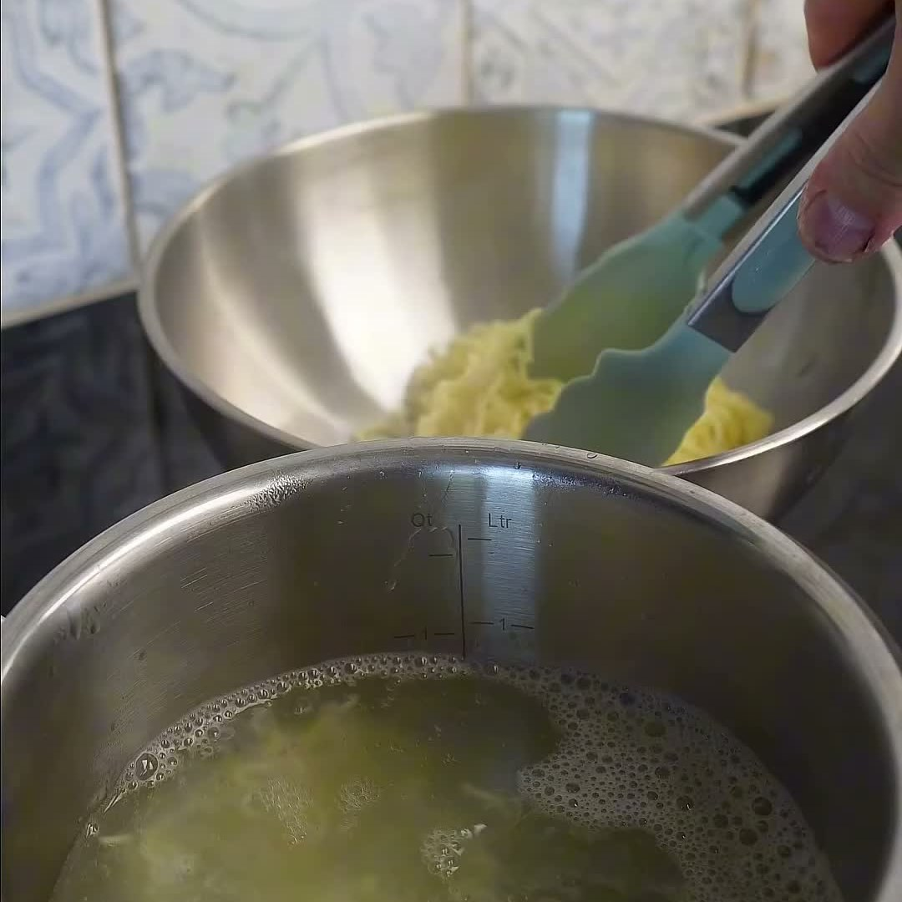

**3. Чеснок.** В сковороду налейте масло и быстро пассеруйте мелко нарубленный чеснок — до запаха, но не до коричневого цвета.

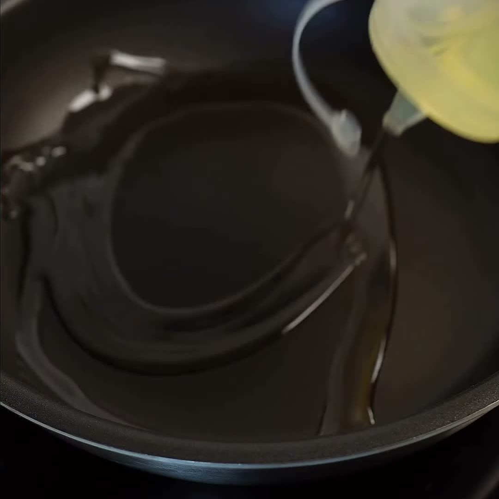

**4. Фарш.** Выложите фарш, разминая лопаткой, распределите по поверхности и дайте схватиться снизу, затем переверните.

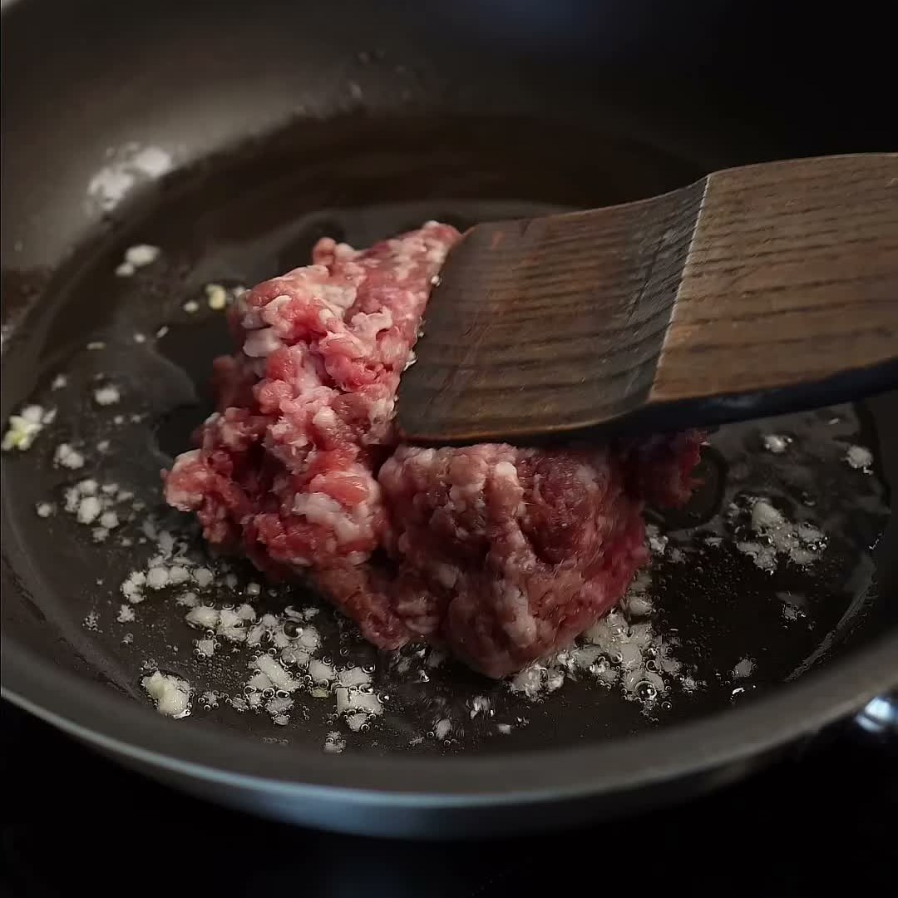

**5. Вино.** Добавьте кулинарное вино и выпарьте его на максимальном огне — уходит спирт, остаётся вкус.

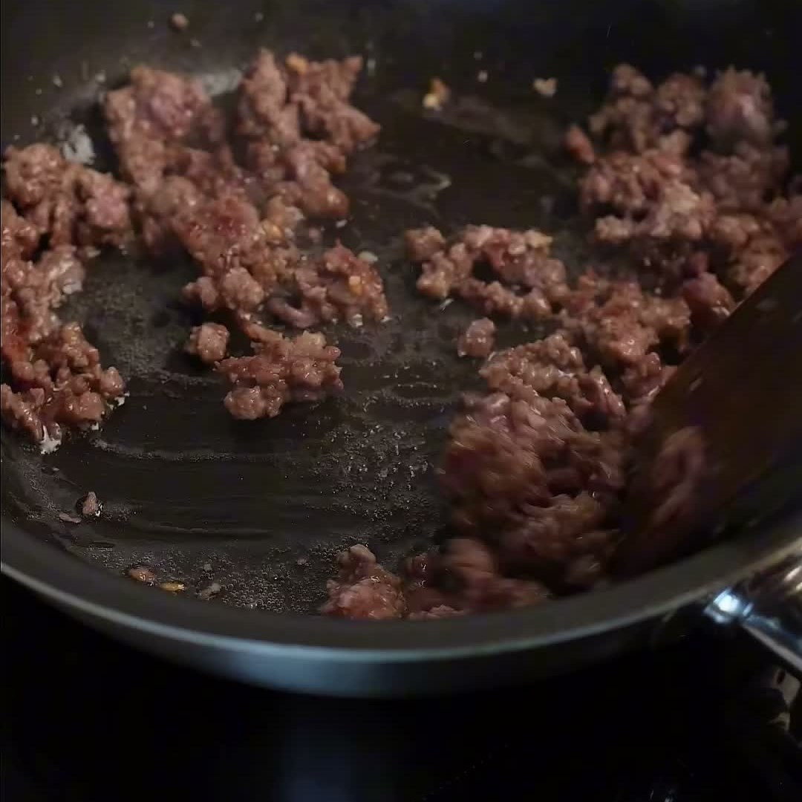

**6. Яйцо.** Разбейте фарш лопаткой на кусочки, выложите яйцо и, размешивая, обжарьте вместе с мясом.

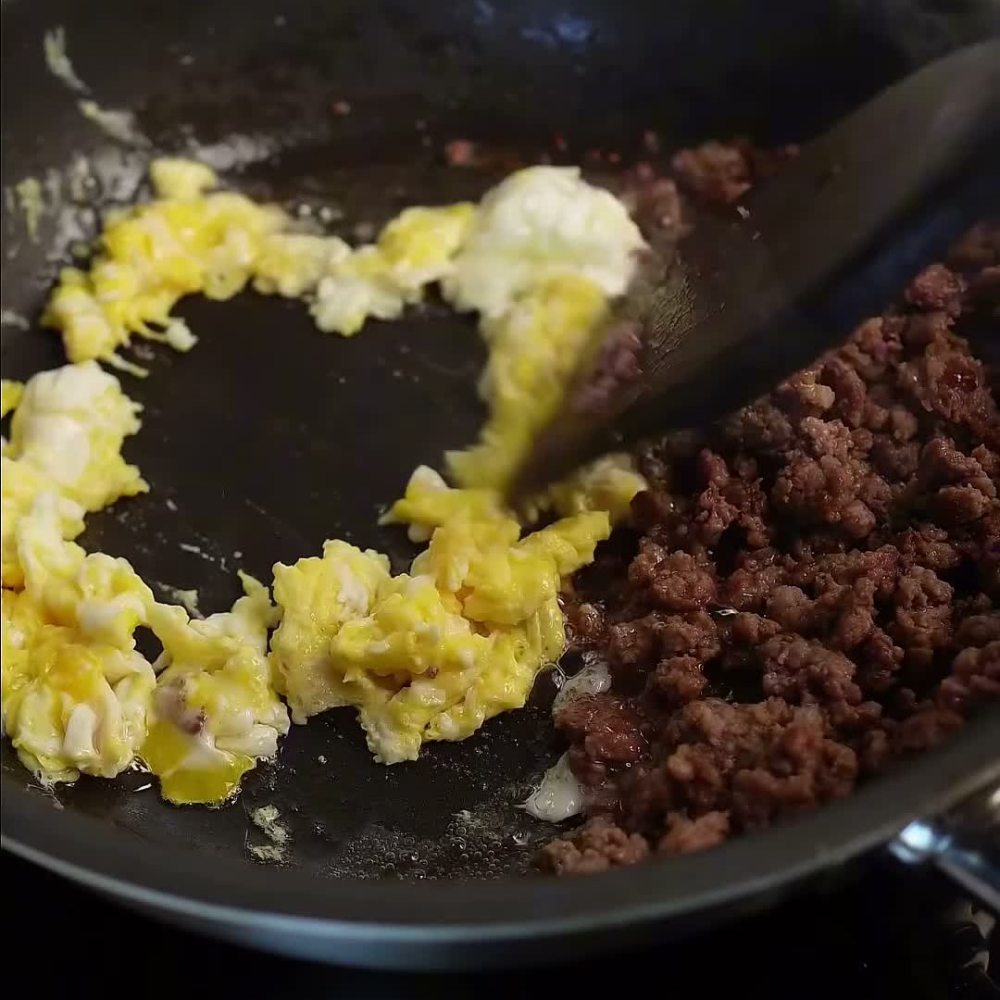

**7. Капуста.** Сдвиньте всё в сторону, добавьте нашинкованную капусту и обжарьте, чтобы она стала мягче, но не разварилась.

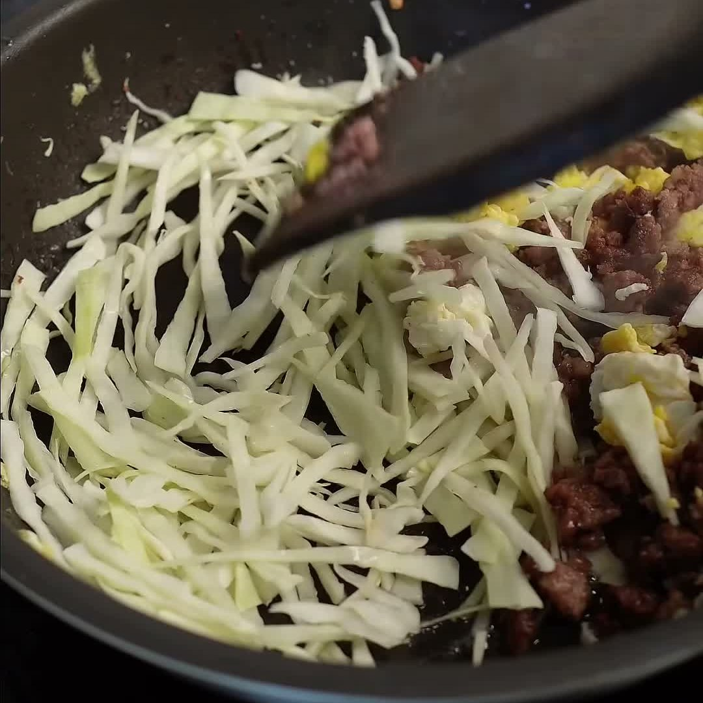

**8. Соусы.** Влейте светлый соевый соус и устричный, добавьте чайную ложку Лао Гань Ма или чили-масла. Перемешайте.

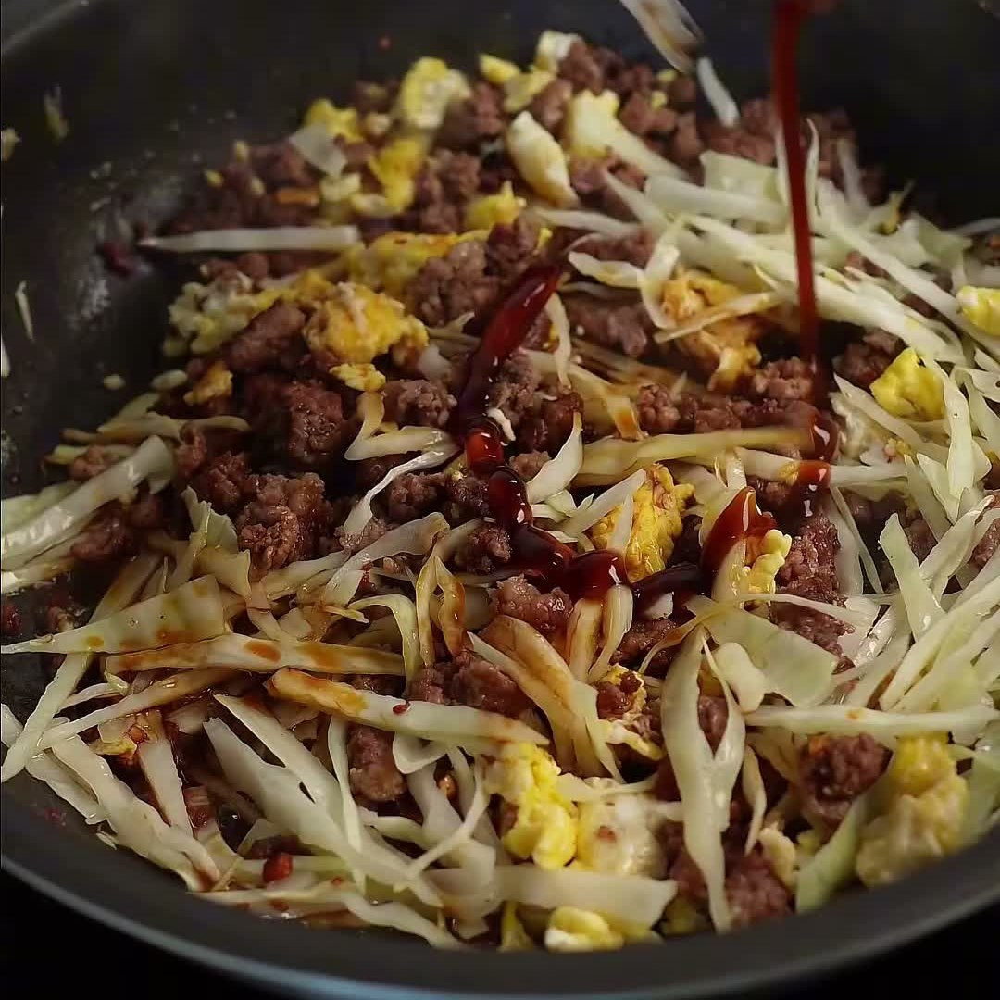

**9. Вернуть лапшу.** Выложите лапшу в сковороду и перемешайте всё до однородности — на этом этапе важно быстро, пока лапша не размякла.

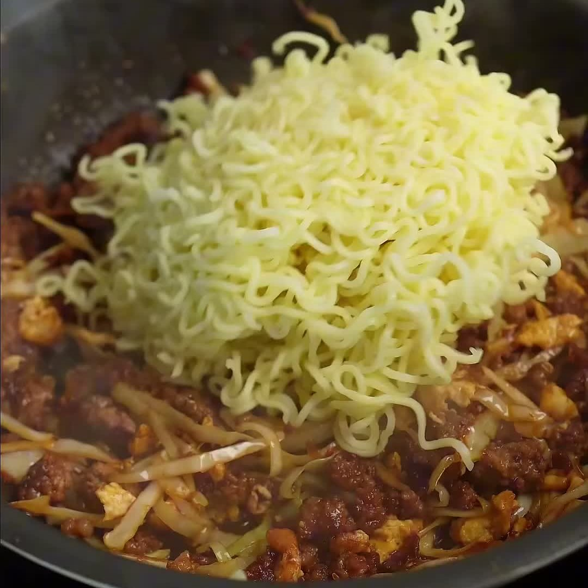

**10. Подача.** Щедро посыпьте зелёным луком и выложите на тарелку. Есть нужно сразу, пока лапша горячая.

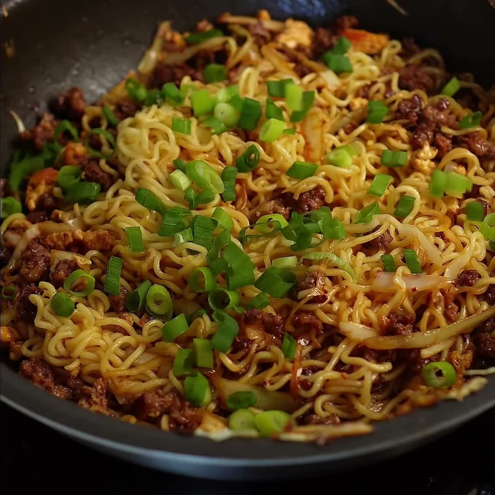

## Заметки

- Всё режьте и отмеряйте до включения огня: вок готовится слишком быстро, чтобы что-то искать по ходу.
- В озвучке автор говорит про светлый и тёмный соевый соус, а в подписи — светлый соевый плюс устричный. Второй вариант мягче и слаще; тёмный соус даст более насыщенный цвет.
- Чили-масло и Лао Гань Ма — взаимозаменяемые варианты. Лао Гань Ма острее и с ферментированным вкусом.
- Капуста должна остаться хрустящей, поэтому её обжаривают недолго на сильном огне.
- Лапша подойдёт любая: рисовая, яичная или обычная быстрого приготовления без приправы из пакетика.

## Источник

- Рецепт: [рилс @luyao82](https://www.instagram.com/reel/DeyfFa-sqma/), 22.10.2026. Ингредиенты — из подписи, порядок действий — из озвучки автора.
- Фотографии — кадры из этого же видео, обрезаны для репозитория. Права принадлежат автору.
