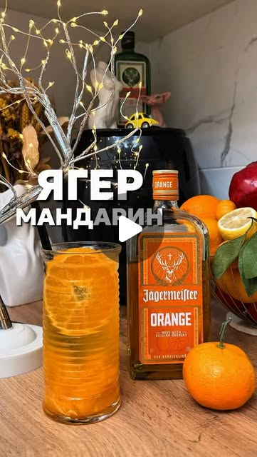

# Мандариновый Ягермайстер

Простой двухкомпонентный коктейль: Ягермайстер, спрайт и мандарин. Пропорция один к двум — ликёр не заглушает цитрус, но и не теряется в газировке.

- **Время:** ~5 минут
- **Выход:** 1 порция
- **Стакан:** хайбол 300–350 мл

## Ингредиенты

| Продукт | Количество |
|---|---|
| Ягермайстер | 50 мл |
| Спрайт | 100 мл |
| Мандарин | 2–3 дольки + слайс для украшения |
| Лёд | сколько влезет, «его всегда много» |

## Приготовление

**1. Лёд.** Наполните высокий стакан льдом почти до края — в рифлёном стекле кубиков уходит много.

**2. Мандарин.** Положите в стакан 2–3 дольки мандарина. Слегка прижмите их ложкой о стенку, чтобы отдали сок.

**3. Ликёр.** Влейте 50 мл Ягермайстера.

**4. Спрайт.** Долейте 100 мл спрайта и аккуратно перемешайте ложкой, не взбалтывая газировку.

**5. Украшение.** Закрепите на краю стакана слайс мандарина — и сразу подавайте, пока лёд не растаял.

## Заметки

- Пропорция 1:2 — базовая. Если хочется крепче, 60 мл ликёра на 90 мл спрайта.
- Спрайт можно заменить на 7Up или тоник — с тоником выйдет заметно менее сладко.
- Ягермайстер можно взять и классический, и Orange: на фото в оригинале именно оранжевая версия.
- Мандарин работает лучше апельсина: он кислее и ароматнее, и коктейль не получается приторным.
- Лёд кладите первым и много: на тёплый напиток лёд тает мгновенно и разбавляет вкус.

## Источник

- Рецепт: [рилс @book_of_drinks](https://www.instagram.com/reel/DfxUVomR0lR/), 15.11.2026. Ингредиенты и порядок — из подписи к видео.
- Обложка — постер рилса (361×640). Сам ролик закрыт возрастным ограничением Instagram и без входа недоступен, поэтому пошаговых фото в рецепте нет. Права на изображение принадлежат автору.
