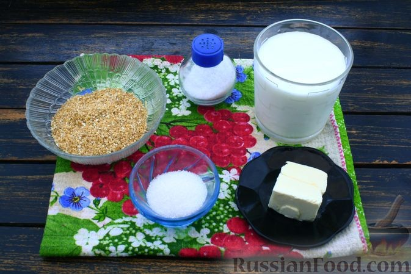
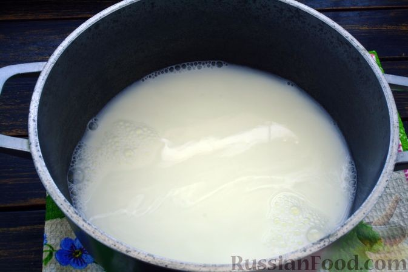
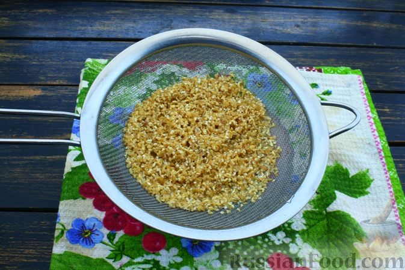
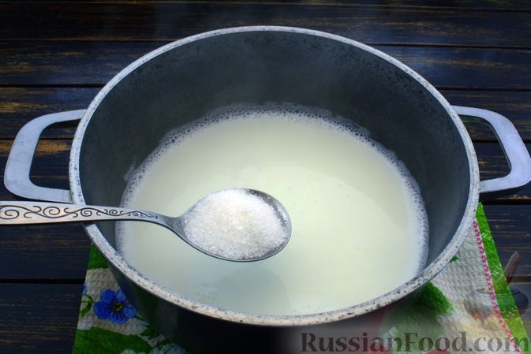
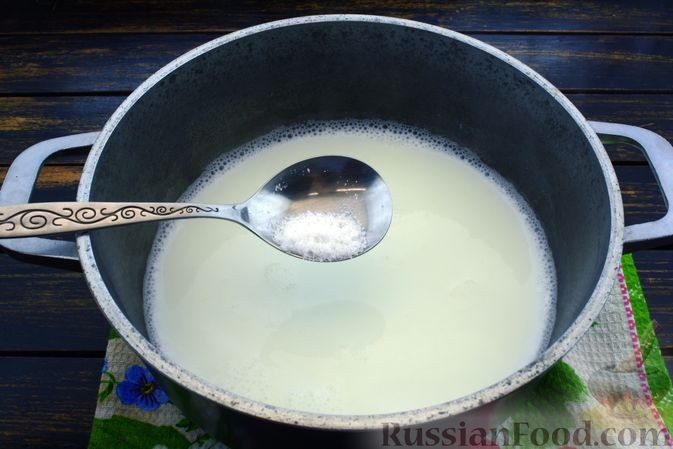
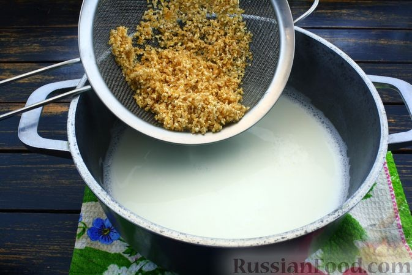
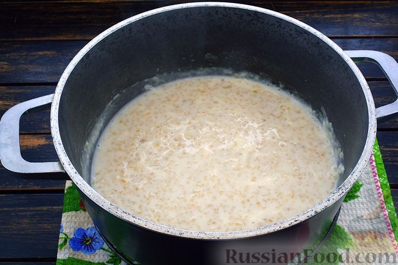
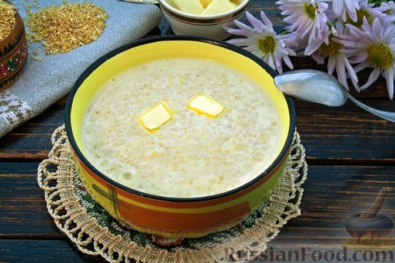

# Жидкая пшеничная каша на молоке

Негустая молочная каша из пшеничной крупы — мягкий завтрак без сиропов и добавок. Варится пополам на молоке и воде, поэтому не пригорает и не получается слишком тяжёлой.

- **Время:** ~40 минут (активной работы ~10 минут)
- **Выход:** 4 порции
- **Кастрюля:** 1,5–2 л
- **Калорийность:** ~180 ккал на порцию (оценка)

## Ингредиенты

| Продукт | Количество |
|---|---|
| Крупа пшеничная | 80 г |
| Молоко | 400 мл |
| Вода | 400 мл |
| Сахар | 20 г (1 ст. л. без горки) |
| Соль | 2/3 ч. л. |
| Масло сливочное (для подачи) | 20 г |

Пропорции пересчитаны на 4 порции: в оригинале было 2, всё увеличено вдвое.

## Приготовление

**1. Подготовка.** Отмерьте крупу, молоко, воду, сахар и соль — дальше всё пойдёт быстро.

**2. Молоко и вода.** В кастрюле соедините молоко и воду (по 400 мл) и доведите до кипения на среднем огне. Смесь из молока и воды кипит спокойнее и меньше норовит убежать.

**3. Крупа.** Пшеничную крупу промойте под проточной водой, откиньте на сито и дайте воде стечь.

**4. Сахар.** В закипевшее молоко всыпьте сахар и размешайте до растворения.

**5. Соль.** Добавьте соль — она нужна даже в сладкой каше, иначе вкус будет плоским.

**6. Крупа в кастрюлю.** Всыпьте промытую крупу и один раз хорошо перемешайте, чтобы она не собралась комом на дне.

**7. Варка.** Варите на маленьком огне с приоткрытой крышкой 20–25 минут, периодически помешивая. Огонь меньше среднего — иначе молоко пригорит.

**8. Отдых.** Снимите кастрюлю с огня, накройте крышкой и оставьте на 10–15 минут. Крупа дойдёт, каша станет однородной.

**9. Подача.** Разложите по тарелкам и добавьте по кусочку сливочного масла — по желанию.

## Заметки

- Каша задумана жидкой: на 4 порции 800 мл жидкости на 80 г крупы. Для более густой уменьшите воду до 200 мл (то есть 400 мл молока + 200 мл воды на 4 порции).
- Промывать крупу обязательно: уходит мучная пыль, каша не липнет к дну.
- Соль не пропускайте даже в сладком варианте — 2/3 ч. л. на 4 порции делают вкус объёмнее.
- Молоко любит пригорать: толстое дно и маленький огонь важнее, чем частое помешивание.
- На следующий день каша густеет. Разогревайте с ложкой молока или воды.

## Источник

- Рецепт: [«Жидкая пшеничная каша на молоке»](https://www.russianfood.com/recipes/recipe.php?rid=164609), автор Yuliya-s, RussianFood.com, 01.11.2021.
- Фотографии — с той же страницы. Права принадлежат автору рецепта и сайту.
