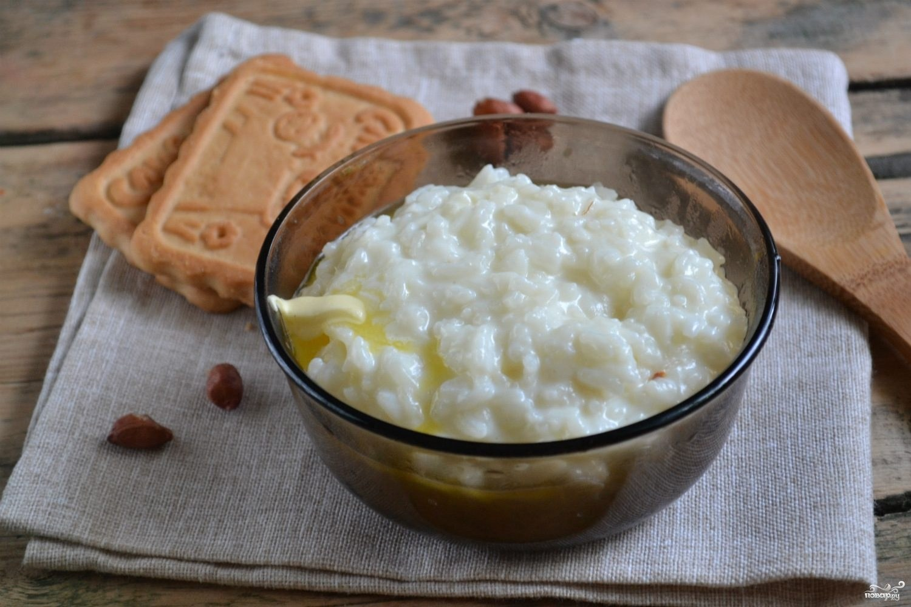
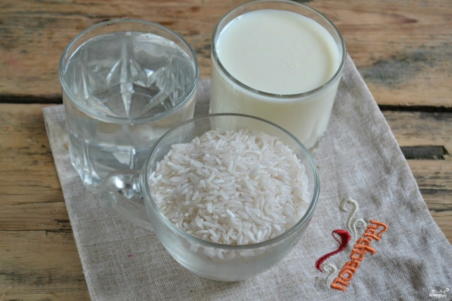
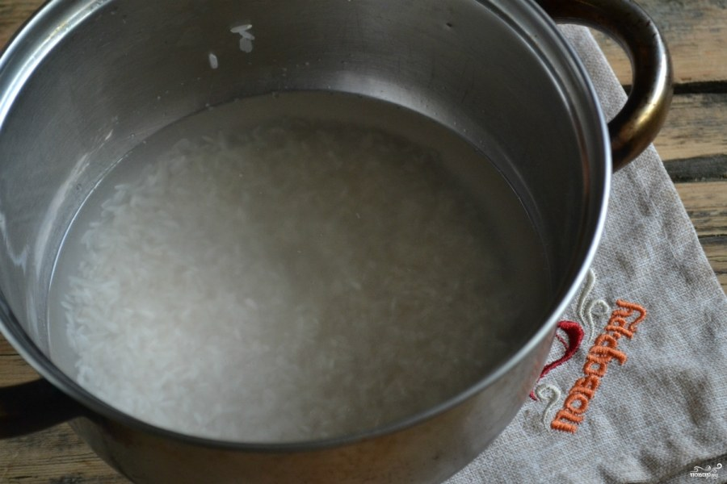
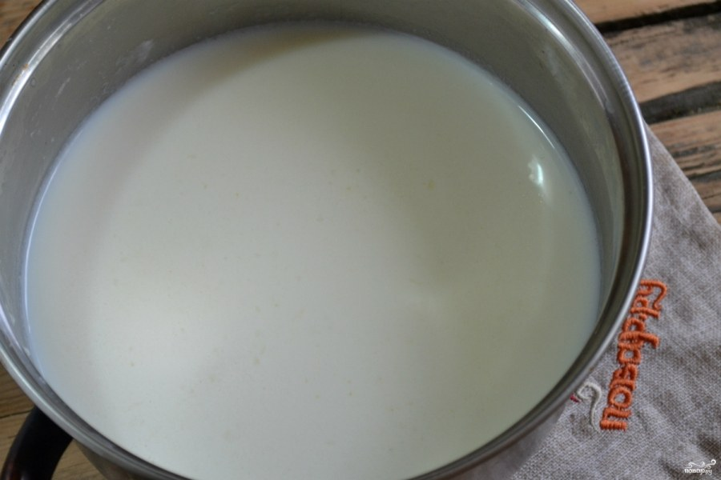
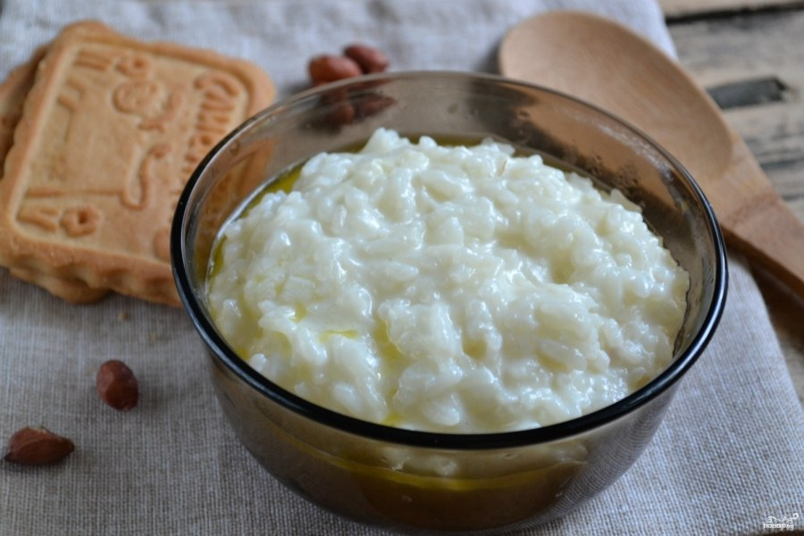

# Каша рисовая молочная

Простая рисовая каша: сначала рис доводится до полуготовности в воде, потом доготавливается в молоке. Так молоко не пригорает, а каша получается мягкой и не водянистой.

- **Время:** ~30 минут
- **Выход:** 3 порции
- **Кастрюля:** 1,5–2 л с толстым дном
- **Калорийность:** ~134 ккал / 100 г (по данным источника)

## Ингредиенты

| Продукт | Количество |
|---|---|
| Рис | 200 г |
| Молоко | 500 мл |
| Вода | 200 мл (1 стакан) |
| Сахар | 1 ст. л. |
| Масло сливочное | 30 г |

Для подачи по желанию: фрукты, ягоды, орехи, печенье.

## Приготовление

**1. Подготовка.** Отмерьте рис, молоко и воду. Пропорция источника: на 1 л молока — 400 г риса; здесь уменьшенная партия на 3 порции.

**2. Рис в воде.** Рис не замачивая промойте, залейте стаканом воды и поставьте на огонь. После закипания варите, часто помешивая, пока вода почти полностью не испарится.

**3. Молоко и сахар.** Влейте молоко, добавьте сахар и варите на медленном огне до готовности. Для густой каши — около 15 минут, но так, чтобы молоко ещё не выкипело полностью.

**4. Подача.** Готовую кашу разложите по тарелкам, сверху — кубик сливочного масла. Хороши фрукты, ягоды, орехи или печенье.

## Заметки

- Промывать рис нужно до прозрачной воды: тогда каша не будет клейкой и не пригорит.
- Если молоко всё же прихватилось ко дну, перелейте кашу в другую посуду, не соскребая пригар.
- Щепотка соли в начале варки делает вкус полнее, хотя в исходном рецепте её нет.
- Для более жидкой, «детсадовской» каши увеличьте молоко до 700 мл на эти же 200 г риса.
- На следующий день каша застывает: разогревайте с ложкой молока на медленном огне.

## Источник

- Рецепт: [«Каша рисовая молочная»](https://povar.ru/recipes/kasha_risovaya_molochnaya-41961.html), автор Марина Софьянчук, Повар.ру, 14.06.2016.
- Фотографии — с той же страницы, уменьшены для репозитория. Права принадлежат автору рецепта и Повар.ру.
