# Сдобные сахарные булочки

Мягкие дрожжевые булочки-«клубочки» с сахаром внутри. Тесто универсальное: подойдёт и для сладких пирожков, и для несладких начинок.

- **Время:** ~2 часа (из них активной работы ~30 минут)
- **Выход:** 7 булочек по 60 г
- **Духовка:** 180 °C, ~25 минут
- **Калорийность:** ~281 ккал / 100 г (Б 8 г, Ж 8 г, У 43 г)

## Ингредиенты

| Продукт | Количество |
|---|---|
| Мука | 500 г |
| Сахар | 65 г |
| Соль | 10 г |
| Яйца | 2 шт, комнатной температуры |
| Молоко тёплое | 200 г |
| Дрожжи сухие | 10 г |
| Масло сливочное | 65 г, комнатной температуры |
| Ванильный сахар | 8 г (по желанию) |

Дополнительно:

- сахар для посыпки — 2–3 ст. л.
- растопленное масло для смазки пласта
- 1 желток + 1 ст. л. молока для обмазки

## Приготовление

**1. Подготовка.** Достаньте яйца и масло заранее — они должны быть комнатной температуры. Отвесьте всё по списку.

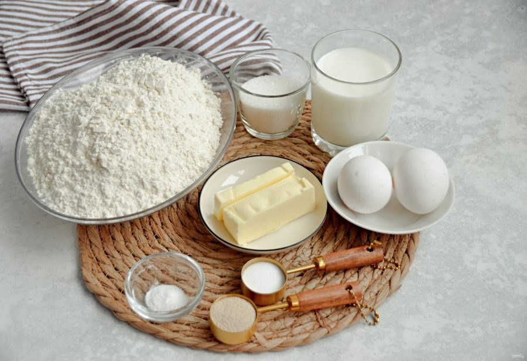

**2. Молоко и масло.** В миску для замеса влейте тёплое молоко (36–38 °C) и положите мягкое сливочное масло.

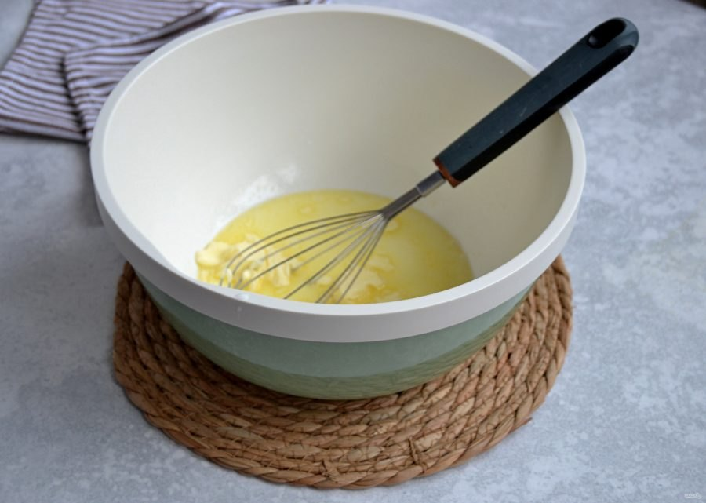

**3. Сахар.** Добавьте сахар и перемешайте.

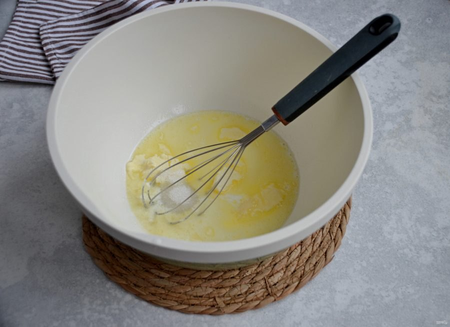

**4. Яйца.** Вбейте яйца и вмешайте в молочно-масляную смесь.

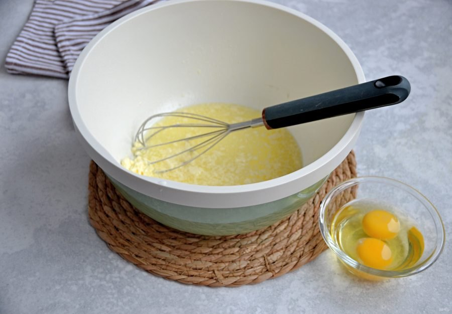

**5. Сухие ингредиенты.** В муку всыпьте дрожжи, соль и ванильный сахар, перемешайте.

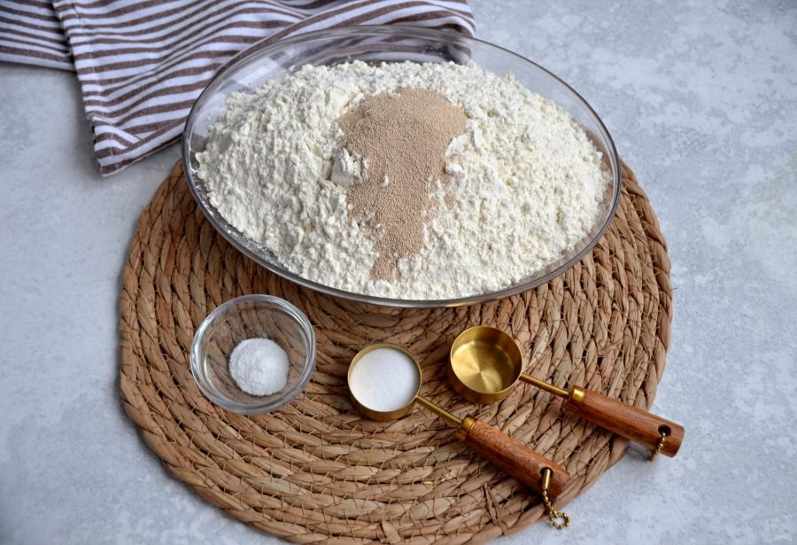

**6. Соединение.** Всыпьте мучную смесь в миску с жидкой частью.

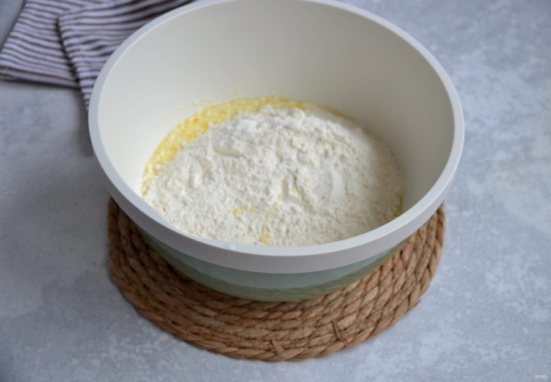

**7. Замес.** Руками или миксером с крюком замесите гладкое тесто, которое не липнет к рукам. Руками — 10–12 минут.

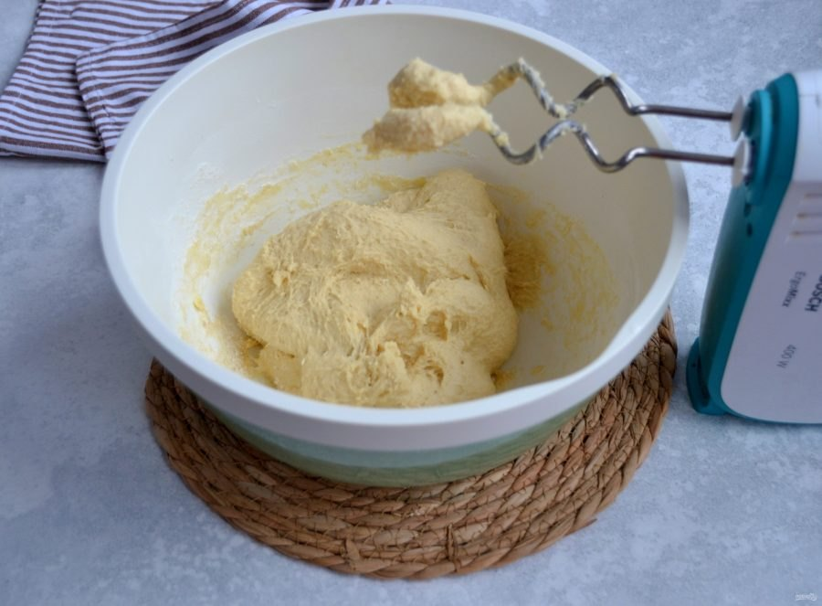

**8. Брожение.** Соберите тесто в шар, переложите в глубокую миску, накройте крышкой и поставьте в тепло на 1,5 часа. Через 45 минут сделайте одну обминку.

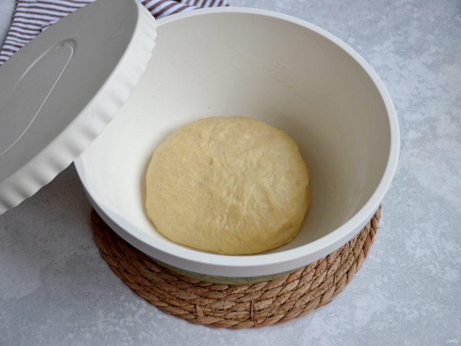

**9. Готовое тесто.** Через полтора часа тесто должно хорошо увеличиться в объёме.

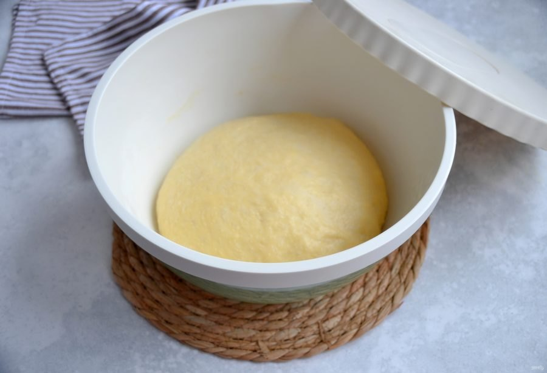

**10. На стол.** Выложите тесто на присыпанную мукой рабочую поверхность.

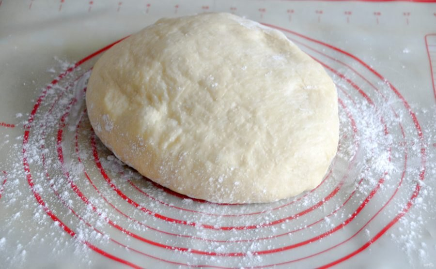

**11. Разделка.** Разделите тесто на куски по 60 г и подкатайте в шарики.

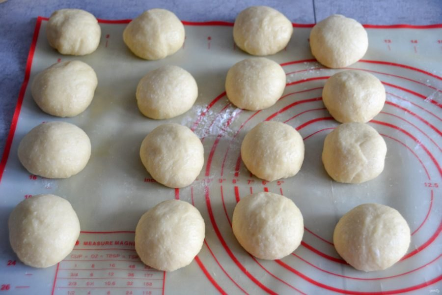

**12. Отдых.** Накройте шарики пищевой плёнкой и дайте отдохнуть 15–20 минут.

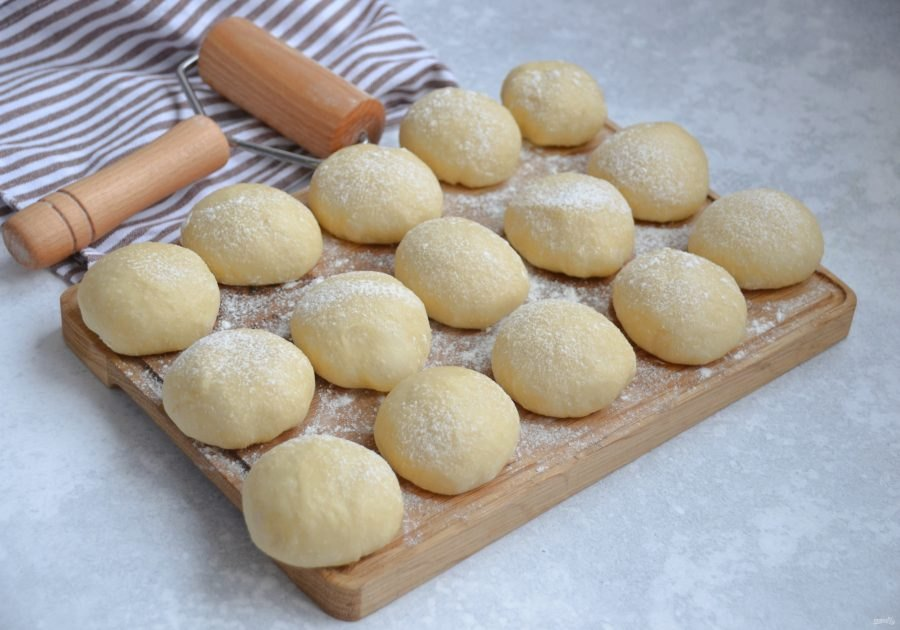

**13. Формовка.** Раскатайте кусок в тонкий продолговатый пласт, сделайте продольные надрезы, не доходя до конца. Смажьте растопленным маслом и посыпьте сахаром.

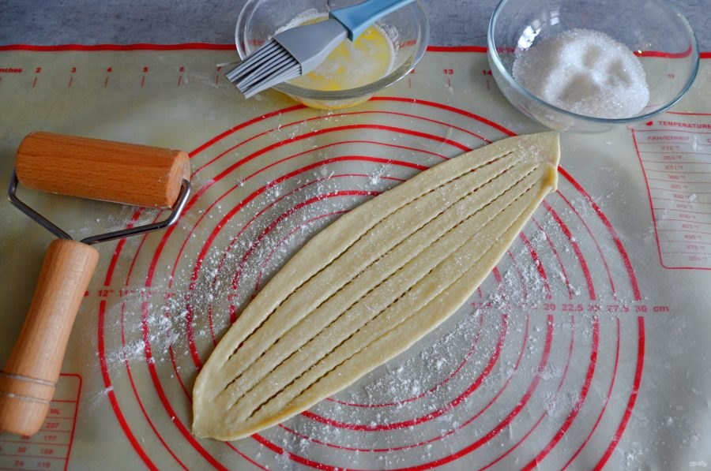

**14. «Клубочек».** Немного растягивая тесто в стороны, перекрутите и сверните его в клубок.

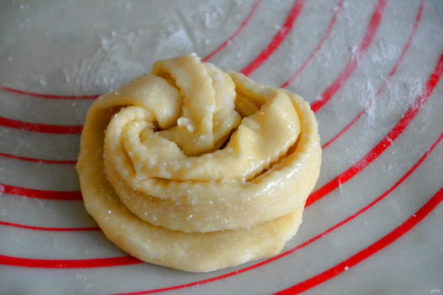

**15. Выпечка.** Выложите булочки на противень с пергаментом, смажьте смесью желтка и молока. Выпекайте при 180 °C около 25 минут до румяной корочки.

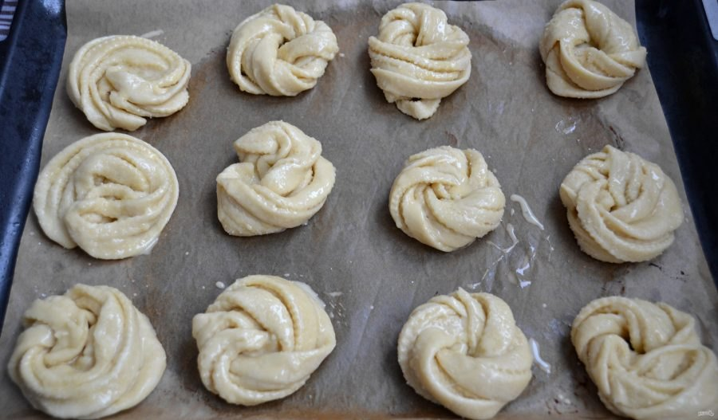

**16. Готово.** Переложите булочки на решётку, чтобы низ не отсырел.

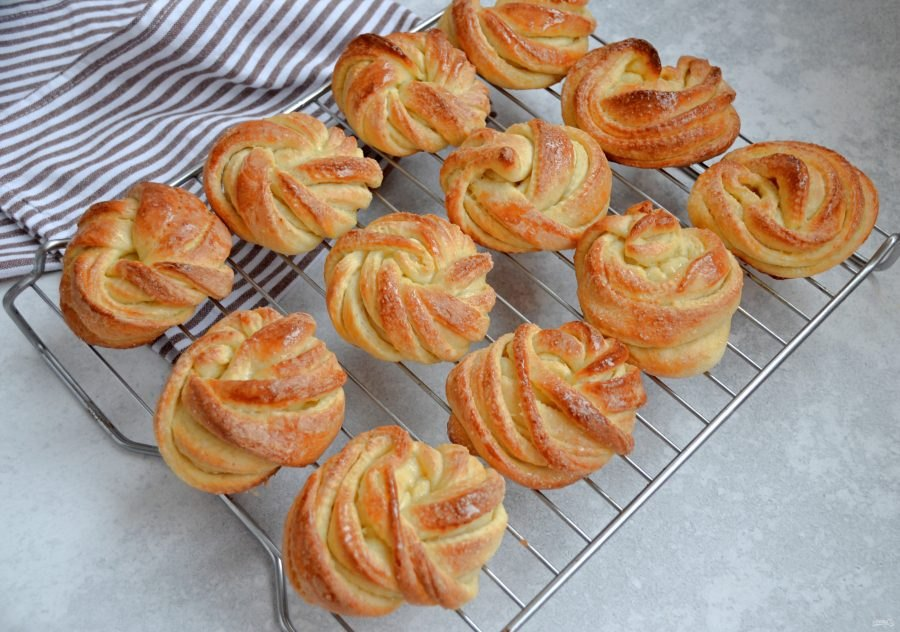

## Заметки

- Сахар внутри пласта — главное, что отличает булочку от сдобного хлеба. Не жалейте 2–3 ст. л.
- Масло лучше вмешивать после половины муки — тесто охотнее держит слои.
- Если тесто липнет, добавляйте муку по одной столовой ложке: перебор муки делает булки плотными.
- Сразу после духовки смажьте растопленным маслом и накройте полотенцем на 10 минут — корочка останется мягкой.
- Для большой партии: 1 кг муки и 50 г свежих дрожжей, 10 булочек, 200 °C, 20 минут.

## Источник

- Рецепт: [«Домашние булочки с сахаром»](https://povar.ru/recipes/domashnie_bulochki_s_saharom-59321.html), автор Наталья Польщак, Повар.ру, 03.12.2025.
- Фотографии пошаговые — с той же страницы, уменьшены для репозитория. Права принадлежат автору рецепта и Повар.ру.
