# Салат Харбин (Хэйхэ)

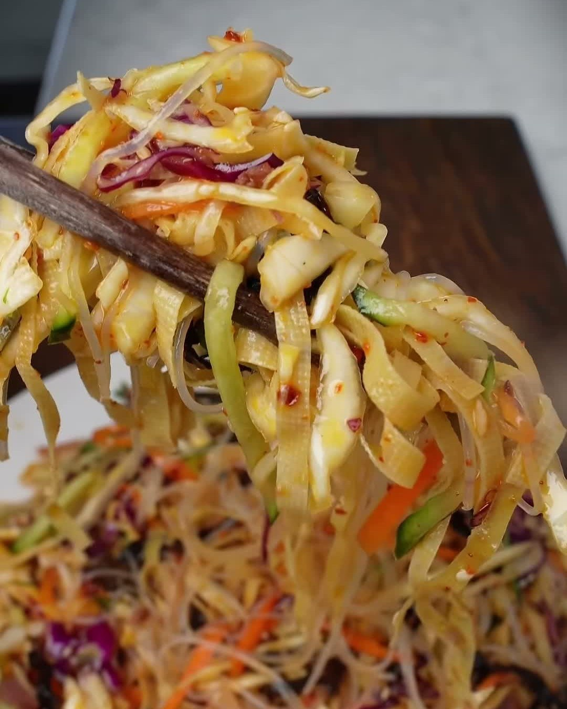

Холодный китайский салат: хрустящие овощи, фунчоза, древесные грибы, сухой тофу и мясо под заправкой из раскалённого масла с чили. Овощи режутся тонкой соломкой — на этом держится текстура.

- **Время:** ~40 минут (включая замачивание грибов и фунчозы)
- **Выход:** 4 порции
- **Подача:** холодным

## Ингредиенты

| Продукт | Количество |
|---|---|
| Капуста белокочанная | 130 г |
| Капуста фиолетовая | 40 г |
| Огурец | 80 г |
| Морковь | 35 г |
| Сухой тофу (фучжу) | 40 г |
| Древесные грибы | 30 г |
| Фунчоза | 140 г |
| Отварная говядина или любое жареное мясо | по вкусу, для верха |

**Для заправки:**

| Продукт | Количество |
|---|---|
| Зелёный лук | 1 ч. л. |
| Чеснок | 1 зубчик |
| Кунжут | 1 ч. л. |
| Порошок чили | 1 ч. л. |
| Хлопья чили | 1 ч. л. |
| Растительное масло (раскалённое) | 3 ст. л. |
| Тёмный ароматный уксус | 3 ст. л. |
| Кунжутное масло | 3 ст. л. |
| Сахар | 4 ч. л. |
| Соль | 1,5 ч. л. |
| Глутамат натрия | 1 ч. л. (по желанию) |

## Приготовление

**1. Морковь.** Нарежьте морковь тонкой соломкой — сначала пластинками, потом полосками.

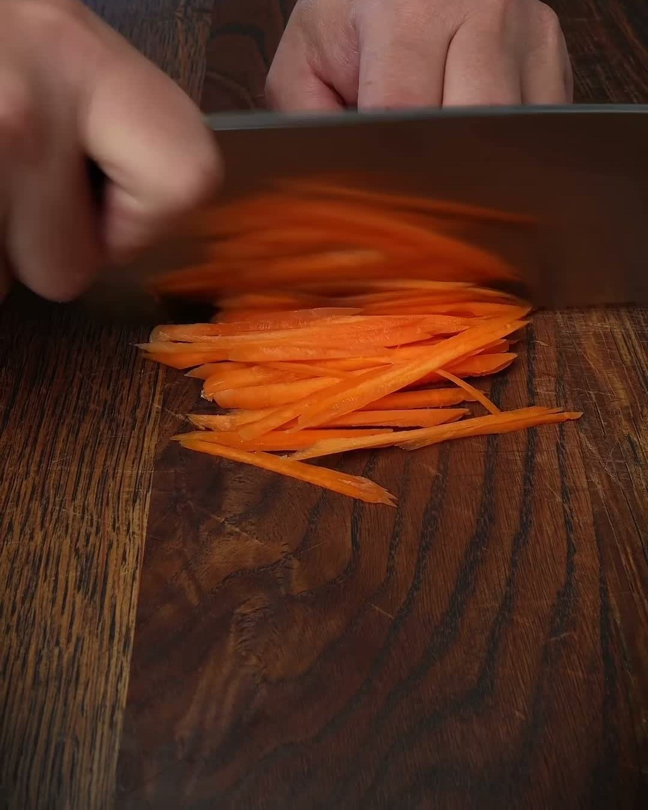

**2. Капуста.** Так же тонко нашинкуйте белокочанную и фиолетовую капусту. Чем тоньше, тем лучше салат впитает заправку.

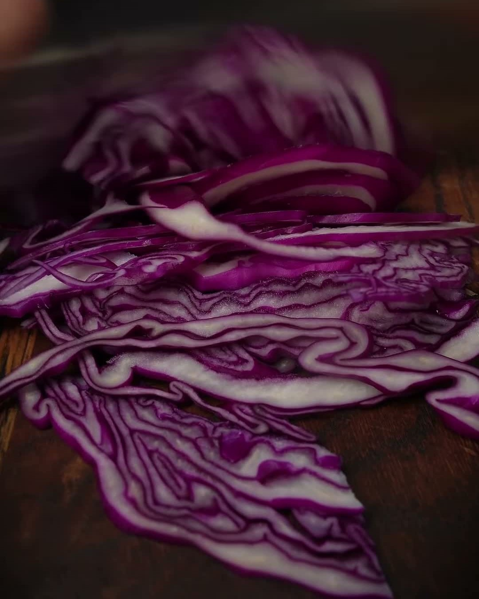

**3. Огурец.** Огурец нарежьте пластинками, затем соломкой и отложите в сторону.

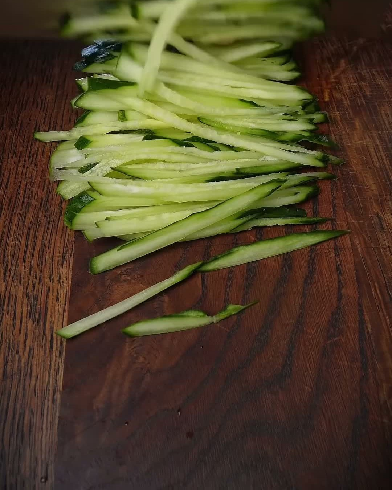

**4. Фунчоза.** Залейте фунчозу кипятком или отварите по инструкции, промойте холодной водой и откиньте на сито.

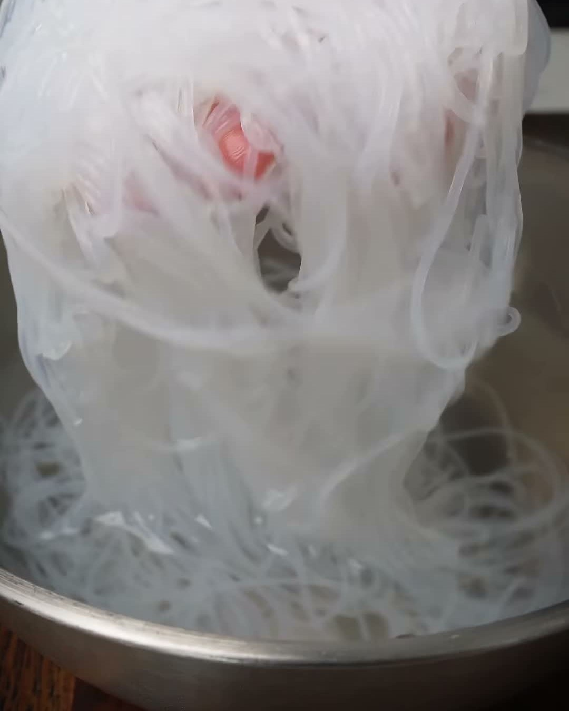

**5. Грибы.** Древесные грибы замочите в горячей воде на 20–30 минут, затем нарежьте полосками.

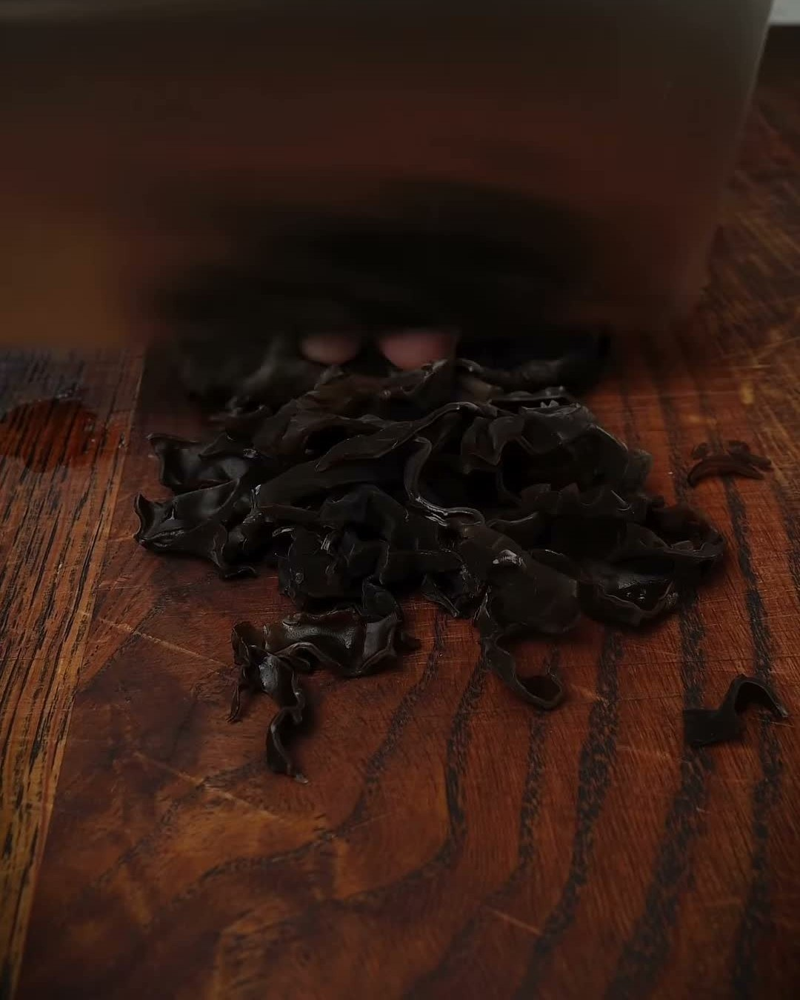

**6. Сухой тофу.** Размочите листы сухого тофу, сверните рулетом и нарежьте тонкими полосками. Разберите их руками, чтобы не слипались.

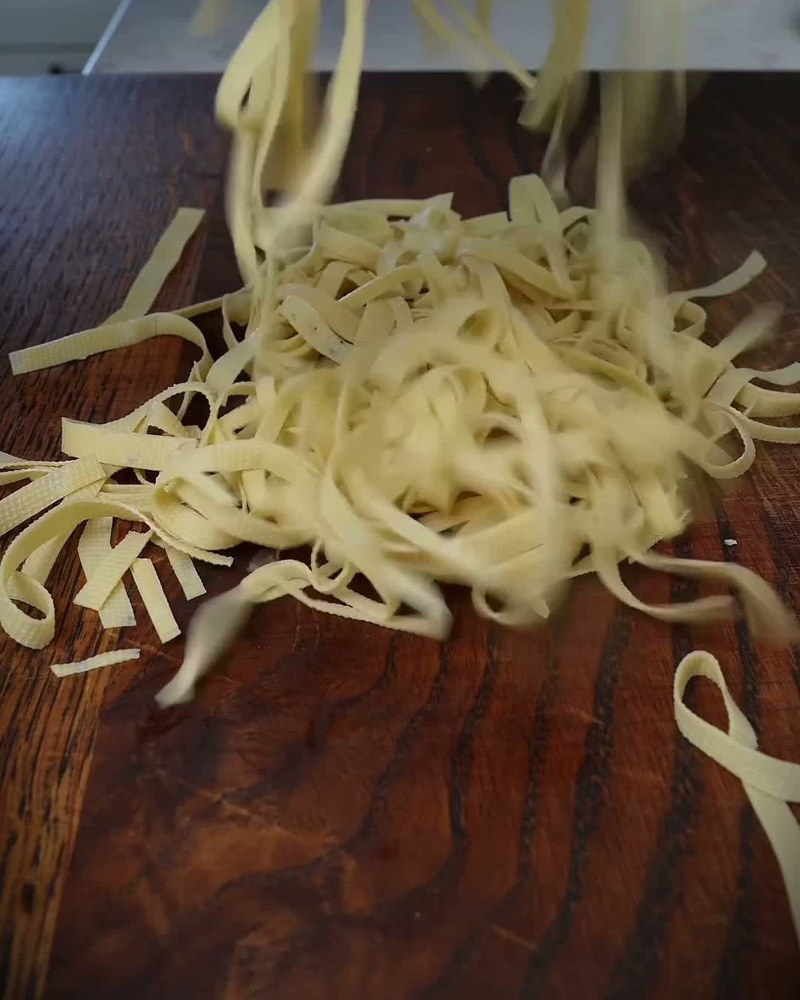

**7. Основа заправки.** В пиалу положите зелёный лук, измельчённый чеснок, кунжут, порошок и хлопья чили.

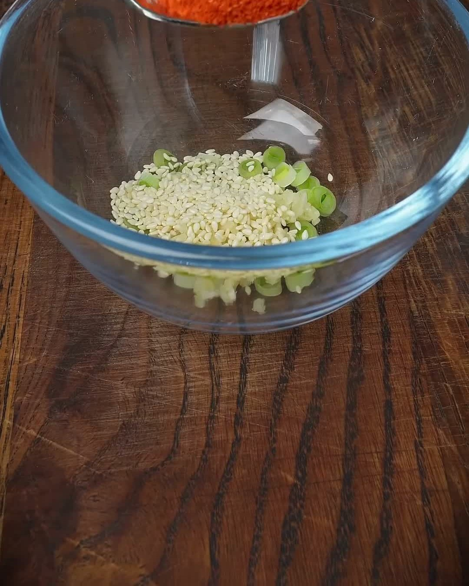

**8. Раскалённое масло.** Залейте специи сильно разогретым растительным маслом — смесь должна зашипеть. Перемешайте.

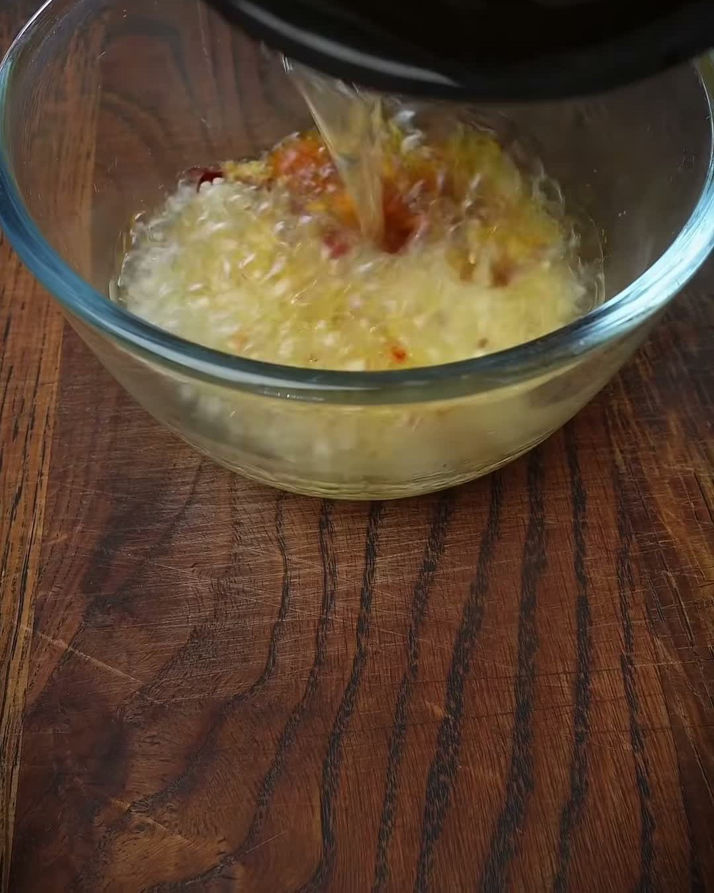

**9. Остальные компоненты.** В ту же пиалу добавьте тёмный уксус, кунжутное масло, сахар, соль и глутамат. Перемешайте до растворения сахара.

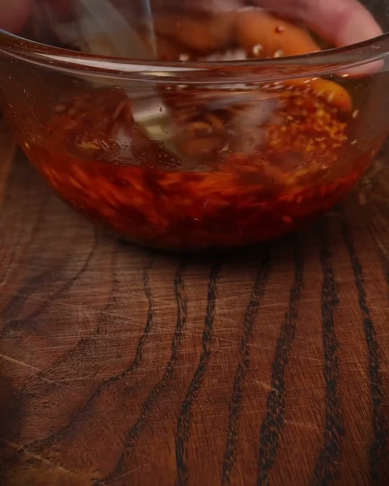

**10. Сборка.** В большой таз или миску выложите капусту, огурец, морковь, тофу, грибы и фунчозу. Залейте заправкой.

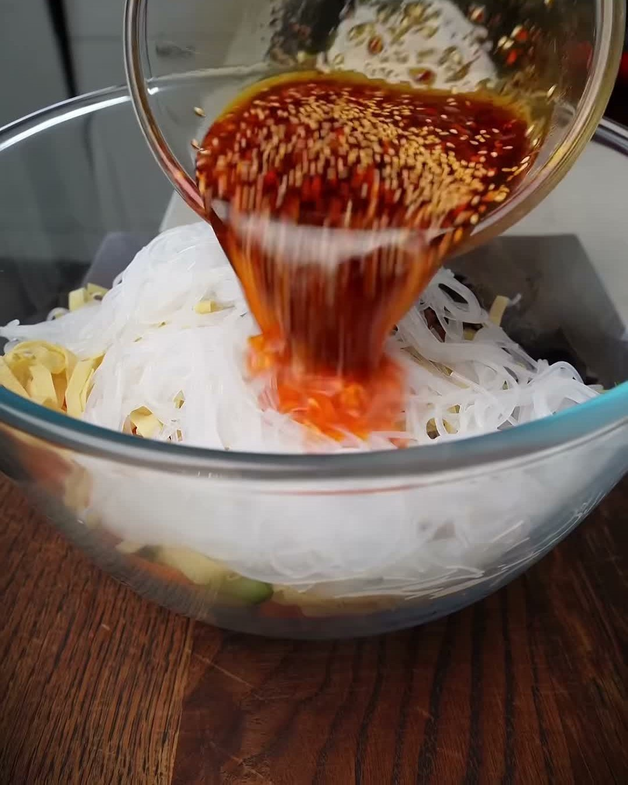

**11. Перемешать.** Тщательно перемешайте руками в перчатке (или двумя ложками) — так заправка ложится равномернее, чем ложкой.

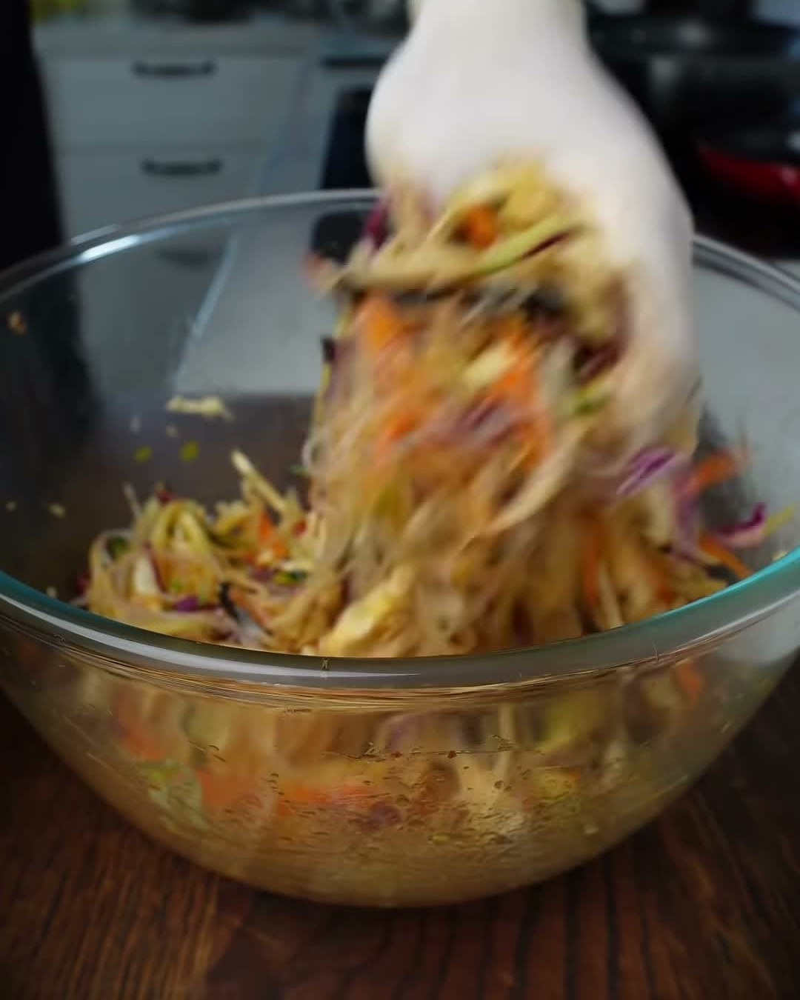

**12. Подача.** Переложите горкой на тарелку и выложите сверху мясную соломку.

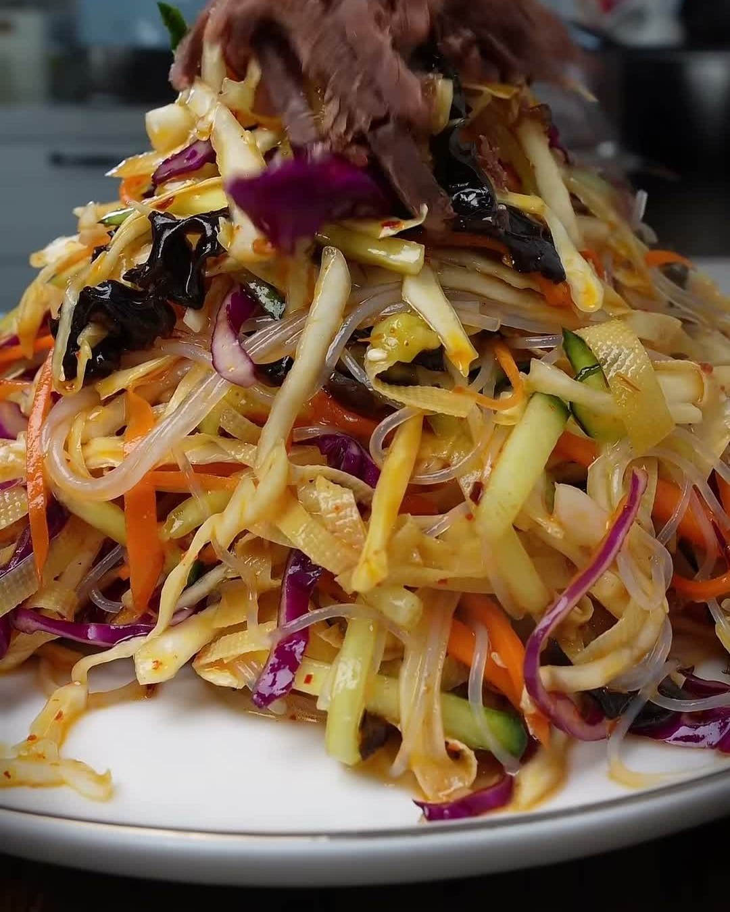

## Заметки

- Соломка должна быть действительно тонкой. Толстые полоски капусты не просолятся и будут хрустеть отдельно от всего салата.
- Масло для заправки нужно раскалить почти до дыма: именно оно раскрывает чили и чеснок. Но не лейте на мокрую пиалу — брызгает.
- Тёмный ароматный уксус — это обычно Chinkiang. Столовый 9% не замена: он резче и без сладкой ноты.
- Глутамат в исходном рецепте есть, но салат хорош и без него — соли тогда можно чуть больше.
- Салат лучше съесть в тот же день: на следующий овощи дадут сок и станут мягче.
- Мясо — вариативная часть: подойдёт отварная говядина, жареная свинина или курица.

## Источник

- Рецепт: [рилс @luyao82](https://www.instagram.com/reel/DXtZciZMYpK/), 29.04.2026. Ингредиенты и граммовки — из подписи, порядок действий — из озвучки автора.
- Фотографии — кадры из этого же видео, обрезаны для репозитория. Права принадлежат автору.
