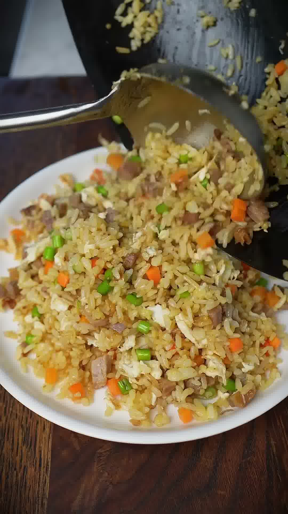
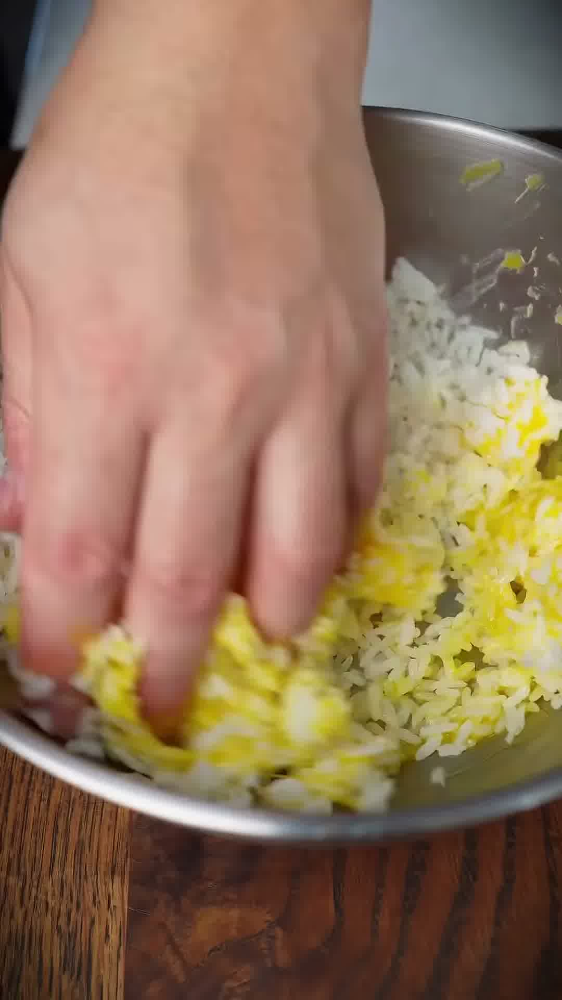
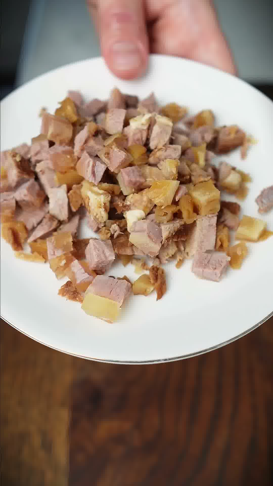
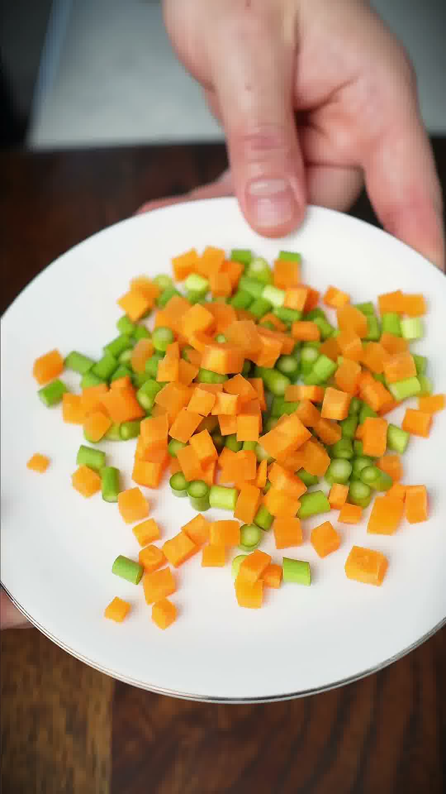
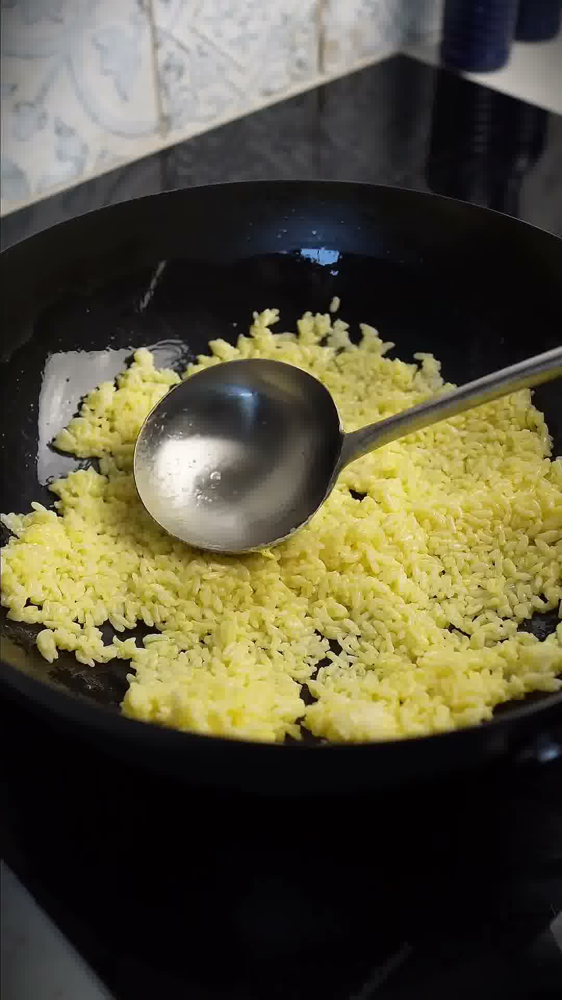
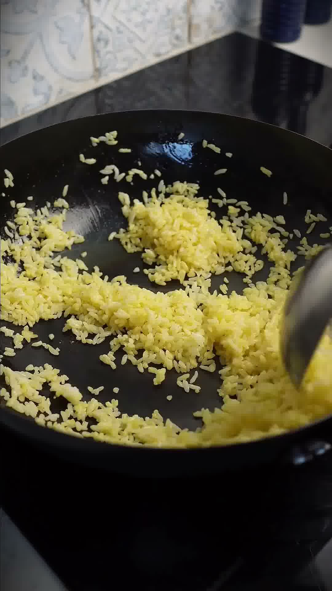
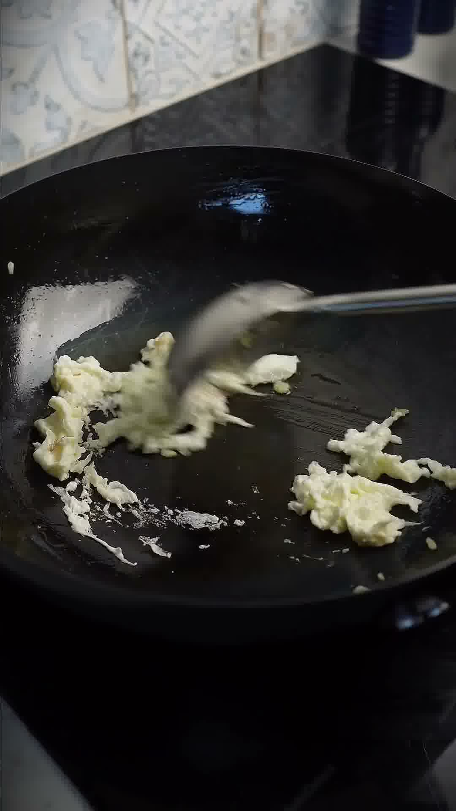
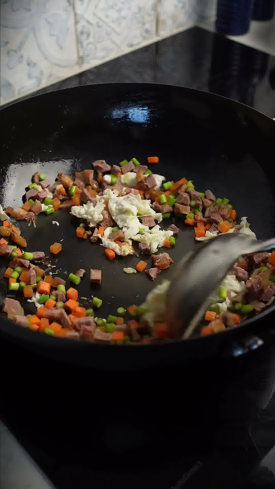
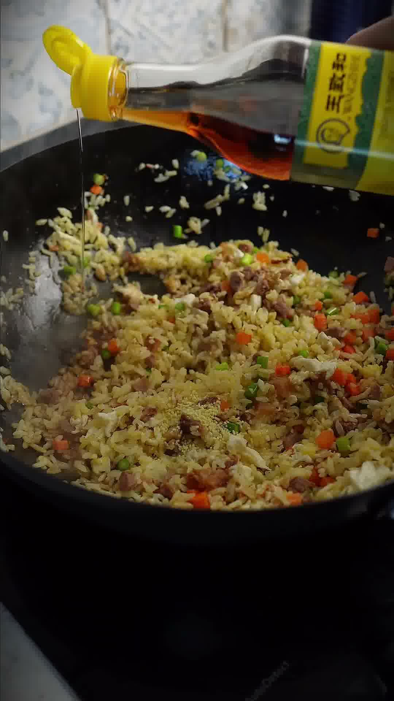
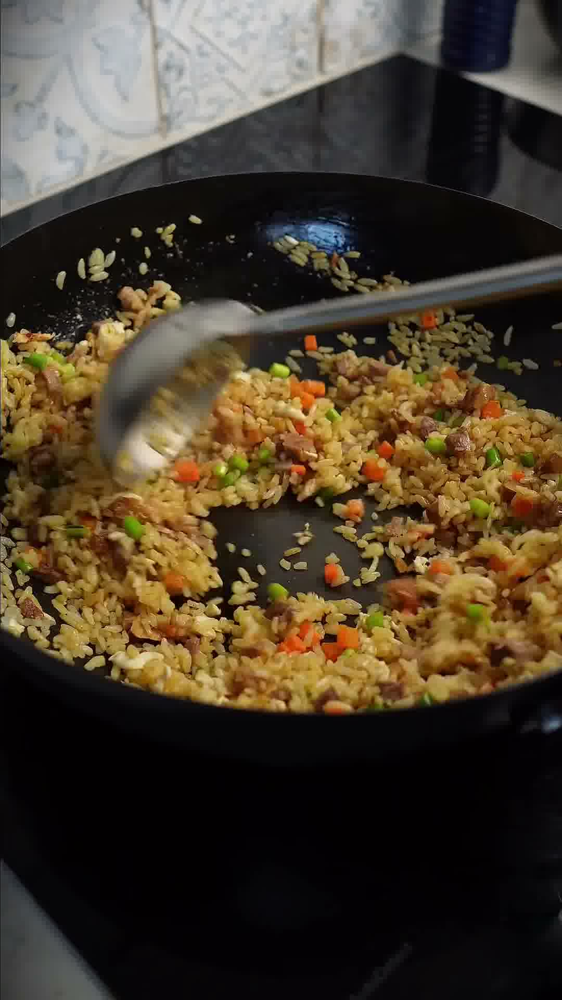

# Жареный рис с говядиной

Китайский жареный рис, где желтки вмешивают в рис ещё до сковороды — рис получается рассыпчатым и золотистым, а белки жарятся отдельно и идут в обжарку вместе с мясом и овощами. Главное — вчерашний рис из холодильника.

- **Время:** ~25 минут (с уже отваренным рисом и готовой говядиной)
- **Выход:** 2 порции
- **Сковорода:** вок или большая сковорода на максимальном огне
- **Калорийность:** ≈ 430 ккал на порцию (оценка)

## Ингредиенты

| Продукт | Количество |
|---|---|
| Рис (вчерашний, из холодильника) | 250 г |
| Яйцо куриное | 2 шт |
| Отварная говядина | 2 ст. л. |
| Морковь | 1 ст. л. |
| Стрелки чеснока | 1 ст. л. |
| Растительное масло для жарки | 2 ст. л. |
| Соль | 1/3 ч. л. (по вкусу) |
| Куриный бульон (приправа) | 1/2 ч. л. |
| Светлый соевый соус | 2 ч. л. |
| Кулинарное вино | 2 ч. л. |
| Кунжутное масло | 1 ч. л. |

Ложки для мяса и овощей — столовые, с горкой не набивать: это добавка к рису, а не отдельное блюдо.

## Приготовление

**1. Желтки — в рис.** Разбейте два яйца и руками выньте желтки, белки оставьте в отдельной миске. Желтки положите в рис и вмешивайте руками, пока каждая рисинка не станет жёлтой.

**2. Говядина.** Отварную говядину нарежьте мелким кубиком — примерно 5 мм, чтобы кусочки успели прогреться за минуту обжарки.

**3. Овощи.** Морковь и стрелки чеснока нарежьте таким же мелким кубиком. Всё должно быть нарезано до включения огня.

**4. Рис на сковороду.** Хорошо разогрейте сковороду с маслом и выложите рис. Плотно прижмите его ко дну лопаткой.

**5. Подрумянить.** Через 30 секунд интенсивно перемешайте. Повторите приём около трёх раз — пока не станет заметно, что отдельные рисинки подрумяниваются. Снимите рис со сковороды.

**6. Белки.** Влейте ещё немного масла и выложите белки. Постоянно помешивая, разбейте их на мелкие хлопья.

**7. Мясо и овощи.** Добавьте морковь, стрелки чеснока и говядину, обжаривайте на максимальном огне около минуты.

**8. Рис обратно, соусы.** Верните рис, добавьте соль, куриный бульон, светлый соевый соус и кулинарное вино. Огонь не убавляйте, быстро перемешивайте и обжаривайте всё вместе.

**9. Кунжутное масло.** В самом конце сбрызните кунжутным маслом, ещё раз перемешайте, снимите с огня и сразу выкладывайте на тарелку.

## Заметки

- Рис только вчерашний, из холодильника. Свежесваренный слишком влажный: вместо рассыпчатого риса получится каша, и никакой огонь это не исправит.
- Смысл трюка с желтками: рис заранее пропитывается яйцом и потом румянится ровнее, а белки не превращаются в «резину» в общей массе. Не взбивайте — именно вмешивайте руками.
- Сковорода и масло должны быть разогреты до лёгкого дымка. На слабом огне рис будет тушиться и липнуть.
- Куриный бульон здесь — порошковая приправа, а не жидкий бульон. Если её нет, замените половиной чайной ложки сахара и щепоткой глутамата — вкус будет близким.
- Кулинарное вино (料酒) можно заменить сухим хересом или рисовым вином. Столовый уксус не подойдёт.
- Говядина — уже отваренная, поэтому её задача отдать вкус, а не дойти до готовности. Сырое мясо сюда не подставляйте: оно потребует другого времени.
- В подписи к видео блок ингредиентов продублирован — список выше собран без повторов, пропорции не менялись.

## Источник

- Рецепт: [рилс @luyao82](https://www.instagram.com/reel/Df4DiuZsSw5/), Сергей Тягубя — «Китайская кухня», 18.11.2026. Ингредиенты — из подписи, порядок действий — из озвучки автора.
- Фотографии — кадры из этого же видео. Права принадлежат автору.
